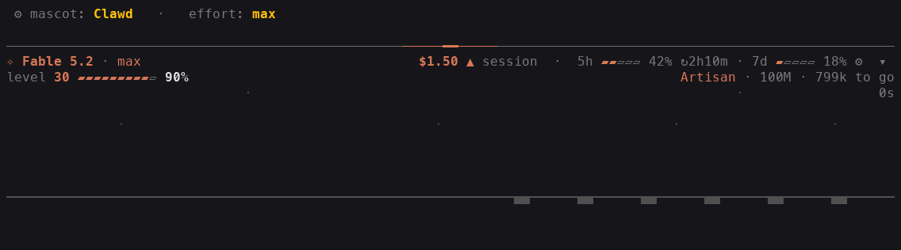
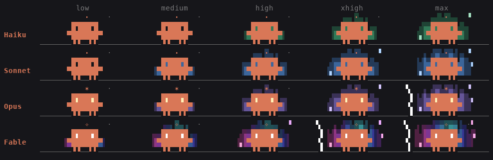
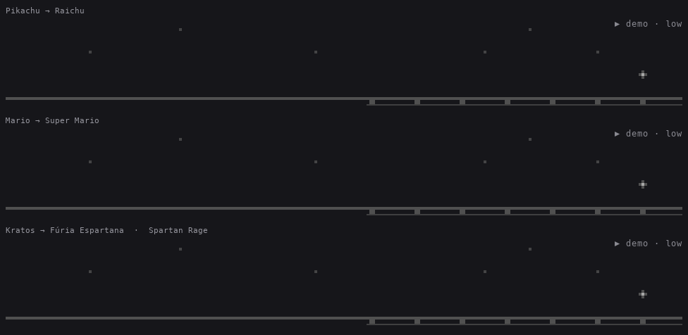
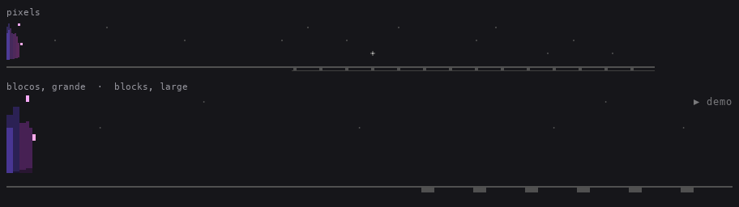

# legends-claude

**English** · [Português](README.pt-BR.md)

A bar above the Claude Code prompt that shows what matters while you work: **model and effort**, **session and turn cost**, **usage limits**, **every running agent**, and a **stage** where the Claude Code mascot builds, brick by brick, what the turn is doing. The mascot changes with the **model** and the **effort**: the stronger the model and the higher the effort, the more it glows. It does not show a context bar.



The bar spans the full width of the terminal. On a narrow terminal, model, cost and limits stack on lines of their own.

## What it shows

| Line | What it shows |
| --- | --- |
| Rule | The top line. While there is work in progress, a `━` pulse starts at the center and runs to both ends: wider and faster the higher the effort. |
| Header | Model and effort of the last request, both **clickable** (see Usage). The spark is the one of the model's class (`✢` Haiku, `✻` Sonnet, `❋` Opus, `❂` Fable; see Power): it pulses while the turn runs and stays dim when idle. Cost and limits sit at the right end of the same line when they fit. |
| Cost | Session total (the same sum `/cost` gives, subagents included) and how much was spent since the last prompt. Two decimal places (`$1.75`). The total lights up with `▲` for a moment whenever it grows. When another session also spent today (or this one started yesterday), the day's cost follows, summed across sessions: `today $9.80`. |
| Limits | The 5-hour and 7-day windows, with the time left until each resets. When, at the pace of the last minutes, a window fills before it resets, the bar says how soon (`full in ~40m`): in amber, and in red with less than a quarter of an hour. Only shown on accounts that report a limit. |
| Stage | Four lines of scene (eight at the large size), while a turn or an agent is running: in real pixels, in terminal blocks, in vector or in text, whichever the screen can show. See below. |
| Work | With the stage off: a comet of sparks `✳✶✻·····`, elapsed time, how many tools were called, how many failed and the last one. With the stage on, this information moves to the scoreboard in its corner. |
| Agents | One line per subagent, teammate or workflow agent: the name emerges from a handful of sparks that settle letter by letter; then the pulsing spark of its model's class (in the color of its helper on the stage), a shimmer over the name and a comet of its own, each out of phase with its neighbor; what it is doing now (the summary Claude Code keeps of it; before there is one, the task's description); a tiny graph of its activity (`▂▁▅█`), elapsed time, tools, failures, what it has cost so far and the last call. When it finishes it becomes `✓` with a burst of sparks that thins out, duration, tokens and cost (or `✗` if it failed), and leaves after 8 seconds. An agent called by another agent sits right under it, indented with `└`. Up to 6 lines by default (3, 6 or 10 in the settings tab); the rest becomes `+N agents`. In the terminal, a click on the line puts the agent's transcript on screen (see Usage). |

## The stage

The stage is not a looping drawing: it reacts to what is actually happening.

- **The mascot** is the one from the Claude Code logo (`▐▛███▜▌` / `▝▜█████▛▘` / `▘▘ ▝▝`), dot for dot. It walks in from the left when the turn starts and waits in the middle of the lane.
- **Thinking, writing or waiting.** The sign over its head follows what the model request is doing, piece by piece of the response. While the model thinks, the spark of its class pulses and its eyes move from side to side. When the answer starts coming out, the spark gives way to three dots, one lit at a time (`·●·`). When it puts a tool call together, the tool's name appears with a blinking cursor (`Bash▁`). While the tool runs, the name gets an ellipsis (`Bash···`) and it raises and lowers its claws. A helper shows the phases of its own agent the same way. The sign only shows while the creature stands still: walking or carrying bricks, there is none.
- **Every tool is a brick.** A tool call becomes a brick on the pile at the left, in the color of its family. The mascot fetches it, carries it on its head (up to six per trip; with a big pile it picks up the pace), puts it on the conveyor belt, and the belt takes it to the **wall** growing at the right, in alternating courses. The brick that just arrived lights up. The wall stays from one turn to the next: it is the picture of what the session did.
- **What failed cracks.** A call that ends in an error (a failing test, a command that exits non-zero, an edit that did not match) or is refused cracks its brick: it goes on to the wall in its family's color, faded, and, where there is detail, with the crack drawn. The wall now shows how much of the work was rework.
- **Floors.** Every hundred bricks the session closes a floor: fireworks go up over the wall. `/legends-claude stats` counts how many there have been.
- **Helpers.** When Claude starts a subagent, the mascot stops, shouts `!`, and a smaller helper pops up behind it in a cloud of sparks, in the agent's color (the same as its spark in the list). The helper carries the bricks of its own agent's tools. Agent waiting: the helper sits down and sleeps (`z`). Agent finished: it jumps, gets a `✓` and vanishes in sparks; if it failed, it dims and gets a `✗`. Up to six helpers on stage.
- **The end.** When the turn ends with an answer, the mascot celebrates: with three tools or more, jumps and confetti in the colors of the bricks; on a short turn, just a little hop. A turn that was interrupted or ended in an error gets no party: the scene simply packs up.
- **The scoreboard** in the top right corner shows the turn's elapsed time, how many tools it called, how many failed and the last one. Where the stage is an image it has no room for text: the scoreboard is the work line, right below it.

The brick colors:

| Color | Family | Examples |
| --- | --- | --- |
| blue | read | `Read`, `NotebookRead` |
| lilac | search | `Grep`, `Glob`, `ToolSearch` |
| green | edit and write | `Edit`, `Write`, `NotebookEdit` |
| amber | shell | `Bash`, `KillShell` |
| cyan | web | `WebFetch`, `WebSearch` |
| pink | agents | `Agent`, `Task`, `SendMessage` |
| orange | MCP tools | `mcp__server__tool` |
| gray | everything else | `TodoWrite`, `Skill`, `AskUserQuestion` |

To see the stage without waiting for a turn: `/legends-claude demo` (or the **▶ demo** button in the settings tab) plays a make-believe turn of about 30 seconds, with the phases of a request, helpers and confetti.

## Power: model and effort

The mascot is not always the same. The **class of the model** decides who it is; the **effort** of the request, how much energy it gives off.



| Class | Spark | Aura | What else |
| --- | --- | --- | --- |
| Haiku | `✢` | green, from `high` up | the usual mascot |
| Sonnet | `✻`, Claude Code's own | blue, from `medium` up | a band of light crosses its body from time to time |
| Opus | `❋` | purple, from `medium` up | eyes lit in gold; a golden band, wider and more frequent; lightning at `max`; golden fireworks at the end-of-turn party |
| Fable | `❂` | shifting colors (cyan to pink, always moving), already at `low` | eyes lit in white; a shifting sheen that has barely passed before it starts again; it **flies** instead of walking (no legs, jets underneath); lightning from `xhigh` up; fireworks in every color |

- **The spark** of each class is the one in the header, in the agent lines and the one pulsing over the head of whoever is thinking: from Haiku's little dot to Fable's seal. A model of an unknown family gets Sonnet's.
- **Effort makes the aura grow.** At `low` there is none; at `medium`, a low glow around the body; from there up, each level widens the glow and raises the flames, which move every frame. From `high` up, whoever runs leaves streaks in the air behind (from Sonnet up only); from `xhigh` up, sparks rise along the sides. On Fable everything starts one level earlier; on Haiku, one later. The rule's pulse follows along: wider and faster.
- **The eyes** of the mascot are two holes: with an aura, it shows through them. From Opus up they have a light of their own.
- **Each helper has the power of its agent**: the model and the effort it runs with. A helper's aura is smaller than the mascot's; asleep or after failing, it has none.
- **Outside a turn**, when only the helpers are still working, the mascot rests: it keeps the eyes and the sheen of its class, without the energy of the effort.
- **On a light theme** the aura fades towards white instead of dark; lightning takes the theme's text color.
- **The colored avatars have an aura of their own.** The class color is the aura of Clawd and of the helpers. Pikachu, Mario, Kratos and Elsa each have the aura of their element and, when it is strong, they transform: see [Mascots](#mascots-clawd-pikachu-mario-kratos-and-elsa).
- Power is drawing only: it does not change what the stage tells (every tool is still a brick) nor anyone's speed.

To see a combination without switching models: `/legends-claude demo opus max` plays the demo with that look (a model, an effort, or both; a word that is neither is refused with a notice). In the demo, one helper is a Sonnet at `high` and the other a Haiku at `max`.

How the text stage is drawn: every terminal cell counts as 2×2 "subpixels", drawn with the quadrant block characters (`▘▝▖▗▀▄▌▐…`), and the background color allows two colors in the same cell. That is why the mascot walks half a cell at a time and jumps half a line at a time. The other ways of drawing it are in [Resolution](#resolution-pixels-blocks-vector-or-text). The scene is a pure simulation, frame by frame, with no randomness: the same state always draws the same frame.

The animation only runs while there is something to show (a turn, an agent, the demo, or the scene winding down: a brick on the belt, confetti falling). When idle, the bar does not redraw and costs nothing.

## Mascots: Clawd, Pikachu, Mario, Kratos and Elsa



Who the mascot is on the stage is picked in the settings tab (`⚙`), on the `mascot` row. The change applies right away and is saved.

| Mascot | What it looks like | Its aura | With a strong aura |
| --- | --- | --- | --- |
| Clawd | The usual one, from the Claude Code logo, in a single color: the accent color from the settings. | The color of the model's class. | The same as ever. |
| Pikachu | Yellow, with dark-tipped ears, red cheeks and the lightning-bolt tail. | **Lightning**: a blue electric field with a spiky outline and yellow crackles around it. | Becomes **Raichu**: orange, with a white belly, yellow cheeks, brown ears and paws, and the thin tail that ends in a bolt. |
| Mario | Red cap and shirt, mustache, blue overalls with yellow buttons, white gloves. | **Star**: the whole rainbow, always moving, with little golden stars rising. | Becomes **Super Mario**: with a yellow cape, from the shoulders to the feet. |
| Kratos | Ash-white skin, the red stripe over the eye, beard, golden pauldron and leather skirt. | **Fire**: orange flames with red tips, yellow next to the body, with embers rising. | Flies into a **rage**: the stripe and the eyes light up, the skin takes the heat of the fire and the fists burn. |
| Elsa | Blond braid over the shoulder, lilac eyeshadow, ice-blue dress down to the floor, sheer sleeves and cape. | **Ice**: the blue of a winter night, with pale-tipped crystals around it and snowflakes falling. | Becomes the **fifth spirit**: hair down and a white dress, with lilac sleeves and ice diamonds. |

- **The bar can pick, too.** `by model` puts the avatar of the model's class on stage: Pikachu on Haiku, Mario on Sonnet, Kratos on Opus and Elsa on Fable; switch the model and the mascot switches. `by session` draws a colored avatar from the session's id: the same one for the whole session, and almost always another in the session next to it, which helps tell windows apart. Either way the tab says who is on stage.
- **Two drawings per colored avatar, and per powered form.** The fine one (36×20 dots) shows wherever there is detail: in pixels, in vector and in `large` blocks. In `normal`-size blocks and on the text stage a low-resolution version (18×5) is used, much simpler: it is what fits in quadrant blocks with two colors per cell.
- **Everything Clawd does, they do.** They blink, look around while thinking, raise their arms to carry and to celebrate, walk, sit down to sleep, and fade when they fail.
- **The aura belongs to the character, not to the class.** On a colored avatar the paints of the aura (and of the streaks, the sparks and the jets) are those of its element, on any model. It is a more vivid aura than a class glow, with three layers wherever there is detail: the heart, lighter, next to the body; the core; and the tips and edges. The effort still gives its size, and the class gives the rest: the spark, the sheen, the lit pupils from Opus up, Fable's flight and the fireworks. The sheen is lighter over a colored avatar, so it keeps showing underneath.
- **The transformation comes with the effort.** The avatar changes form when the aura reaches the strength at which the sparks rise: from `xhigh` up on Sonnet and Opus, already at `high` on Fable, only at `max` on Haiku. Outside a turn, asleep or after failing it goes back to the base drawing.
- **Lightning is Pikachu's.** The crackles show with any aura, and once it becomes Raichu yellow bolts strike beside it, on any class and more often than those of Opus and Fable. Fire, star and ice follow the class rule for lightning.
- **Snow is Elsa's.** The outline of her aura is made of crystals: each tip has its own place and grows or shrinks slowly, instead of waving like the flames or jumping like the electric field. The core is the faintest layer (it is glass: the background shows through) and what shines are the tips and the edges. And what she lets loose are snowflakes: they fall down the sides instead of rising, land above the floor and melt there. On a light theme the tips, the edges and the snowflakes swap the pale cyan and the white for a deeper blue, so they do not vanish into the background. The dress goes down to the floor: in place of legs, its hem and the tips of the cape sway from one step to the next. And her eyes stay blue on any model: from Opus up only the bottom line of each one lights up, and closed or looking sideways they do not light up.
- **Their colors are their own.** The accent color does not paint a colored avatar; it still applies to the rest of the bar (the spark, the model, the comet, the rule).
- **The helpers do not change**: they are still the small Clawds, each in its agent's color.
- The choice is drawing only: all of them have Clawd's width and head, so the stage tells the same story with any of them (where it stops, how many bricks it carries).

Elsa is here in honor of my daughter: with her as the mascot, the settings tab says so next to the `mascot` row.

Pikachu, Raichu, Mario, Kratos and Elsa are characters and trademarks of their owners (Nintendo / The Pokémon Company, Sony Interactive Entertainment and Disney). The drawings here are fan-made pixel art, with no affiliation with or endorsement by those companies.

## Resolution: pixels, blocks, vector or text

The stage is one scene drawn four ways. The bar picks the best one the screen can show (the **resolution** setting, `auto` by default) and the settings tab says which one is in use.



| Drawn as | Where | What you get |
| --- | --- | --- |
| **pixels** | a terminal that draws images: kitty, Ghostty, iTerm2 3.5 or later with Claude Code's fullscreen rendering (inside tmux too, with `allow-passthrough` and `focus-events` on) | The scene as a real image, 8×16 pixels for each cell: bricks with relief, a slanted band of light crossing the body, flames you can see through, particles a few pixels wide, and pixel icons over the heads (the spark of whoever is thinking, the dots of whoever is writing, an icon for the tool's family, which fades in and out while the call is being put together and is solid and bobbing while it runs, `!`, `✓`, `✗`, `z`). |
| **blocks** | every other terminal | A grid of terminal cells. Each cell takes the block that comes closest to its pixels (`▁▂▃▄▅▆▇`, `▏▎▍▌▋▊▉`, the halves, the quadrants) and two colors, so the flames end at any eighth of a cell. The signs, the scoreboard, the floor and the stars stay as text. |
| **vector** | the desktop app | The same drawing as an SVG. |
| **text** | the `classic` resolution, or a Claude Code version without the new elements | The stage as it always was: quadrant characters, 2×2 "subpixels" for each cell. |

- **Smoother motion.** In pixels and in blocks the stage is repainted in place between two frames of the simulation, about 25 times a second, while the bar itself still redraws 8 times a second: the creatures glide from where they were to where they are going, the bricks roll along the belt and the sparks fly, instead of jumping. In blocks a creature moves half a cell at a time, the finest step a block can draw against the terminal's own background.
- **How the bar finds out.** In a terminal, the first drawing carries a transparent one-pixel image in a corner and asks Claude Code to repaint it: the answer says whether the terminal draws images. Until it arrives (a fraction of a second) the stage is in blocks. If images stop working halfway (a tmux without passthrough, say), the stage goes back to blocks by itself.
- **Size.** `large` doubles the stage (eight lines) and gives its world half the width of the bar, so each block shows more: in blocks, the relief of the bricks, the volume of the body, the slanted band of light and the floor line appear, as they do in pixels. It needs a terminal at least 118 columns wide and 11 free lines in the band; without that the stage stays at the usual size and the settings tab says so. It has no effect on the text stage.
- An image carries no text: in pixels and in vector the scoreboard goes back to the work line, right below the stage.
- To keep the stage exactly as it was before version 0.9, pick `classic`. To ask the terminal again whether it draws images (after turning tmux's passthrough on, say), pick `auto` again.

## Installation

At the prompt of a Claude Code session in the terminal:

```
/plugin install legends-claude --marketplace leolegends/legends-claude
```

Or straight from the shell:

```
claude plugin install legends-claude --marketplace leolegends/legends-claude
```

Claude Code asks `Add marketplace?` (answer `y`) and then the scope: choose **user** for the bar to apply to every session. It starts working right away, with no restart.

In the desktop app, where `/plugin` does not run: click **+** next to the prompt, then **Plugins**, **Add marketplace** with `leolegends/legends-claude`, and **Add plugin**.

To update: `claude plugin update legends-claude` and then `/reload-plugins`.
To remove: `claude plugin uninstall legends-claude`.

## Usage

- **Click the model** (`Fable 5.2`) to open a picker in the bar itself: `model  ● Fable  Opus  Sonnet  Haiku  ✕`. Clicking one runs `/model <name>`, as if you had typed it: the change is the session's and, like every `/model`, it is saved as the default for the next ones.
- **Click the effort** (`high`) to open `effort  low  medium  ● high  xhigh  max  ✕`, which runs `/effort <level>`.
- In the middle of a turn the change is queued and applies when the turn ends. `✕` (or clicking the model/effort again) closes the picker without changing anything.
- **Click an agent's line** (in the terminal) to put its transcript on screen, like the switch from Claude Code's task list. The bar then says whose it is (`viewing Explore · find routes  ← main`) and underlines its name in the list. `← main`, or another click on the same line, goes back to the main conversation. If Claude Code does not switch the view, a notice repeats the reason.
- **From the keyboard.** `ctrl+x tab` moves the focus to the bar: `Tab` or the arrows walk the buttons (agent lines included) and `Enter` presses. The focus ring follows what opens: in a picker it lands on the option in force (the session's model, the effort of the last request), and in the settings tab, on the language; when that closes, it goes back to the button that opened it. `Esc`, or starting to type, returns the focus to the prompt.
- `▾` at the corner of the bar hides it; `◂ status` brings it back. `/legends-claude` toggles between hidden and visible.
- `/legends-claude demo` plays the stage, with the session idle. `/legends-claude demo fable max` plays it as another model and effort, without changing the session's.
- `/legends-claude stats` shows the tallies: the bricks (every tool call is one), the floors, the failures and the turns of this session; today's cost summed across sessions; the all-time total; and the records (the longest turn, the one that called the most tools, the most agents at once). The text shows in the conversation for you alone: it does not go to the model.
- **`⚙` opens the settings tab** in the bar itself (or `/legends-claude settings`; `ajustes` works too). Every change applies immediately and is saved for the next sessions:

```
⚙ settings                                                   ▶ demo   restore defaults   ✕
language     Português  ● English
color        ● Claude  Blue  Green  Purple  Pink  Cyan  Amber  Mono
mascot       ● Clawd  Pikachu  Mario  Kratos  Elsa  by model  by session
sound        ● off  low  loud
animation    ● full  subtle  still
speed        slow  ● normal  fast
resolution   ● auto  blocks  classic    in use: blocks
size         ● normal  large
show         ☑ rule  ☑ stage  ☑ limits  ☑ turn cost  ☑ day cost
agents       3  ● 6  10
```

| Setting | What it does |
| --- | --- |
| language | English or Portuguese: switches every text in the bar, the notices and the command's description at once. With no saved choice, a fresh install follows the system language (`LC_ALL`, `LC_MESSAGES`, `LANG`): Portuguese if it says `pt`, English otherwise. "Restore defaults" leaves the language alone. |
| color | The accent color: the mascot, the spark, the model, the comet, the rule's pulse, the lit-up cost. Each option is already shown in its own color. `Claude` and `Mono` follow Claude Code's light/dark theme. |
| mascot | Who the mascot is on the stage. `Clawd` is the usual one, in the accent color. `Pikachu`, `Mario`, `Kratos` and `Elsa` are colored avatars with their own colors (the accent color still applies to the rest of the bar): in pixels, vector and large blocks they show in the fine drawing; in normal-size blocks and on the text stage, in a low-resolution version. Each colored avatar has the aura of its element (lightning, star, fire, ice) and transforms at a high effort (Raichu, Super Mario, Kratos in a rage, the fifth spirit); the sheen, the lit eyes and the flight follow the model's class. `by model` and `by session` leave the choice to the bar (see [Mascots](#mascots-clawd-pikachu-mario-kratos-and-elsa)). The helpers are still the small Clawds. |
| sound | The bar's sounds, eight-bit, made by the mod itself (there is no audio file): the fanfare of a turn that worked, a ping on a short turn, a helper being born, a failure (a turn that ended in an error, an agent that failed), a floor closing, and two beats when Claude asks you a question or waits for a plan to be approved. `off` is the default; picking a volume plays a sample. It only plays on macOS: on other systems the tab says so. |
| animation | `full` is everything, stage included; `subtle` keeps only the pulsing spark and the comet (no stage, rule pulse, emerging name, shimmer or burst); `still` moves nothing and only updates the time once a second. |
| speed | The duration of a frame: 200, 125 or 80 ms. It is also the pace of the stage. No effect while the animation is still. |
| resolution | What the stage is drawn in. `auto` is the best the screen offers: real pixels in a terminal that draws images, terminal blocks in the others, vector in the desktop app. `blocks` keeps the blocks even where there are pixels. `classic` is the text stage. Next to the options, the tab says what is in use on this screen. |
| size | `normal` is the four-line stage; `large` doubles it (see [Resolution](#resolution-pixels-blocks-vector-or-text)). It only applies outside the text stage, and where the bar has room. |
| show | Turns the top rule, the stage, the 5h/7d limits, the turn cost and the day cost on and off. The stage only appears with the `full` animation. |
| agents | How many agent lines appear before the `+N agents` summary. |

## Requirements and limits

- Claude Code with mod support (function hooks). Written and tested on versions 2.1.322, 2.1.327 and 2.1.330. This API is in early access and may change between versions.
- The bar needs a terminal at least 60 columns wide; below that it does not draw. On a bar wider than 120 columns the stage does not stretch past that.
- The band above the prompt may take up to half the terminal's height. If the stage does not fit (fewer than 7 free lines) it stays out and the work line comes back; if it only just fits, it is the agent list that shrinks to `+N agents`.
- The stage in pixels needs a terminal that draws images (the kitty graphics protocol with placeholders, or iTerm2's inline images) and a Claude Code version with the `Image`, `Raster` and `$.ui.blit` pieces of the mod API. Where one of them is missing the bar falls back by itself: to blocks, and from blocks to text.
- The stage in blocks and in text uses the Block Elements characters (`▀▄█▌▐`, the eighths, the quadrants) and 24-bit color. On a terminal without 24-bit color the brick and aura colors are approximated; in a font without those blocks the drawing does not close up.
- In pixels, in blocks and in vector the colors are painted as RGB, not as theme colors: the ones that come from Claude Code's theme (the mascot's `Claude` accent, the helpers' colors, the floor) are close approximations for the light and the dark theme.
- Repainting the stage between frames costs one to three milliseconds each time (measured outside Claude Code), and only while the scene is moving and the stage is on screen.
- The spark of each class uses glyphs from the Dingbats block (`✢ ✣ ✤`, `✸ ✹ ✺ ❋`, `✧ ✦ ✪ ❂ ❉`), like Claude Code's own; in a font missing one of them the terminal shows its replacement.
- The aura fades towards the terminal's background, and the mod only knows whether the theme is light or dark from its name (the `theme` row of `/config`): a theme whose name does not say `light` counts as dark.
- Each agent's cost, summary and activity come from Claude Code's agent list, checked once a second. On a version that does not carry them, the line shows the task's description and, when it finishes, the tokens of its last turn.
- While Claude Code waits for you with a dialog on screen (a permission request, a question), it does not draw the band above the prompt: the bar goes away and comes back when you answer. And the permission, notification and conversation-compaction events do not reach a mod (seen on version 2.1.330, on a team account). So the stage has no scene for those moments; what there is is the question's sound, which the mod recognizes by the tool.
- The limit forecast comes from the readings the bar saw in this session (the last 30 minutes for the 5-hour window, the last 6 hours for the 7-day one) and asks for a minimum of time and of rise: right after the session opens there is no forecast. The percentage is the account's, so other sessions' usage counts in the pace.
- The tallies count what the bar saw: a session without the plugin loaded is not in them, and the cost is Claude Code's estimate (on a subscription it is not a charge). Each session writes only its own record, at the end of every turn, and that is when it rereads the others' (at most once a minute): while this session is idle, the day's cost on the bar does not follow what the others spend. A record idle for three days goes into the all-time total and leaves the store.
- The effort appears from the first model request after the plugin loads; until then the bar shows `effort`, already clickable.
- The model picker uses the aliases `fable`, `opus`, `sonnet` and `haiku`; a model your account does not have is refused by `/model` itself, and the bar says so.
- Agent lines are only clickable in the terminal; in the desktop app they stay as text. It is Claude Code that switches the view, and only in answer to a click or a key of yours: it may refuse (an agent that already left the task list, a teammate in a pane of its own), and the bar shows the reason.
- The focus ring only follows what opens and closes while the bar holds the keyboard (`ctrl+x tab`). On version 2.1.327 a click on a button presses it without giving the bar the keyboard, so nothing changes for mouse users.
- The phases of a request come from the pieces of the model's response, which the bar passes on exactly as they came. It only looks at what kind each piece is (thinking, text, the start of a call) and at the name of the tool being called: it neither keeps nor shows the text.
- The plugin accesses neither the network nor files. It reads the session's usage, the agent list, the theme (the `theme` row of `/config`, and its changes), the session's id and the operating system; keeps its state in the session and, in the plugin's own store (a JSON file in Claude Code's configuration folder), the settings and the tallies (one record per session, with counts and cost per day: no text of the conversation); reads three environment variables (`LC_ALL`, `LC_MESSAGES`, `LANG`) to pick the first language; and plays its sounds through Claude Code itself. The stage's scene lives in memory only and starts over with each session or `/reload-plugins`.
- The stage is decoration: an error in it becomes an empty scene and one notice line; it never gets in the way of a tool or takes the bar down.
- The `⚙` icon is drawn as text in most terminals; in a terminal that shows it as a wide emoji, the first line may lose a column at the right.

## Development

```
claude plugin validate .
claude plugin test .
claude --plugin-dir .        # runs a session with the plugin loaded from this folder
```

The hooks module and what it imports, in `hooks/`:

- `register.tsx`: the events, the state, the animation clock and the assembly of what the bar draws. `bar.tsx`: the assembled bar (the rule, the header with its buttons, the lines), pure. `stage-draw.tsx`: from the scene to the stage element of one draw. `engine-calls.ts`: what the bar asks of the engine without touching its own state (the error notice, the theme, the saved settings, the focus ring, the view switch).
- `lines.ts`: the lines of the bar (header, cost, work, limits, agents), pure. `bar-rows.tsx`: the rows of buttons under the header (the model or effort picker, and the one that says whose transcript is on screen).
- `phase.ts`: what each piece of a model request says about its phase (thinking, writing, putting a call together). `focus.ts`: which button the focus ring lands on when something opens in the bar.
- `pace.ts`: the pace of a limit window and the forecast of when it fills. `stats.ts`: the tallies of a session, of the day and of all time, pure; `ledger.ts`: their record in the plugin's store. `sound.ts`: the sounds, from the tune to the WAV.
- `effects.ts`: the text animations (spark, comet, rule pulse, emerging name, burst, shimmer).
- `format.ts`, `parts.ts`, `agents.ts`: text formats, line parts, and the agent lines reconciled with the engine's list.
- `sim.ts`: the stage simulation, pure: the state and the functions that give the next state.
- `scene.ts`: the drawing of one frame of the scene as text (bubbles, bricks, belt, stars). `pose.ts`: what each creature is doing in a frame, shared by the text stage and the pixel one.
- `hd.ts`, `hd-aura.ts`, `hd-art.ts`: the same scene in pixels, between two frames of the simulation: a list of rectangles of paint, with the aura, the particles and the small drawings (bricks with relief, icons, floor).
- `canvas.ts`, `png.ts`, `blocks.ts`, `vector.ts`: from the rectangles to a frame of pixels, to a PNG (the mod has no zlib: the encoder is its own), to terminal cells (the block and the two colors that come closest to each cell) and to SVG.
- `stage.ts`, `stage-node.tsx`, `painter.ts`: which way the stage is drawn on each screen, its element (`Image`, `Raster` or `Svg`), and the clock that repaints it between frames and asks the terminal whether it draws images.
- `power.ts`: the power of whoever is working: the model's class, the effort's step, the aura's strength and the spark of each class.
- `aura.ts`: the look of a creature with power, pure: the aura (the class's, or that of an avatar's element: fire, lightning, star, ice), the body's sheen, the eyes, the sparks (and the snowflakes), the crackles, the lightning, the jets and the fireworks.
- `pixels.ts`, `sprites.ts`, `palette.ts`, `color.ts`: the subpixel renderer (with the glow behind the scene), the creatures' drawings, the colors and the color math.
- `avatars.ts`, `elsa.ts`, `avatar-kit.ts`: the mascot's colored avatars, as text: each one's palette, the common and the fine drawing, with the stances as patches over it; and, for each one, the element of its aura and its powered form (another drawing, declared before the base one). Elsa's drawings have a file of their own, and `avatar-kit.ts` has what all of them use to draw themselves. A new avatar is a new drawing (in a file of its own), an entry in `AVATAR_ART`, an option in `settings.ts` and a name in the `StatusAvatar` type.
- `demo.ts`: the script of the demo.
- `i18n.ts`: the bar's texts in Portuguese and in English. A new text goes into the `Strings` type and the compiler demands its translation in both.
- `settings.ts`, `settings-panel.tsx`: the settings and their tab.
- `types/index.d.ts` (at the root): the contract of the state the plugin keeps.

The code comments and the test names are in Portuguese, the language the project was born in.

The tests (`*.test.ts`, 627 in all) cover the pure functions, the simulation frame by frame, the drawing of the scene, the power of each class, the aura and the form of each avatar, the PNG encoder and the fit to blocks, and the bar mounted on each surface, in text, in blocks, in pixels and in vector: the phases of a request piece by piece, an agent's transcript on screen and the focus ring included. The test kit does not hand a test the request to move the focus ring (`$.ui.focus`): the ring actually moving is checked in a real Claude Code (`claude --plugin-dir .`, `ctrl+x tab`).

The GIFs of the two READMEs come out of the same functions that draw the bar, outside Claude Code (needs `bun` and Pillow). The make-believe turn has the large stage, in blocks, as most terminals show it, and the mascot switches avatar at each stretch: Clawd as Fable max and then Pikachu (Opus), Mario (Sonnet) and Kratos (Opus), each one first at `high`, in the base drawing, and then at `max`, transformed; `scripts/demo-frames.ts` still gives a turn with a single model and effort. The power table is the same in both languages:

```
bun run scripts/cast-frames.ts 112 en | python3 scripts/demo-gif.py docs/demo.gif 10
bun run scripts/cast-frames.ts 112 pt | python3 scripts/demo-gif.py docs/demo.pt-BR.gif 10
bun run scripts/power-frames.ts | python3 scripts/demo-gif.py docs/power.gif
```

The GIF of the pixel stage is made of the stage alone, in two strips that run together (the frame files are large: keep them out of the repository):

```
bun run scripts/stage-frames.ts /tmp/pixels.bin 100 pixels normal fable max
bun run scripts/stage-frames.ts /tmp/large.bin 112 blocos grande fable max
python3 scripts/stage-gif.py docs/stage.gif "pixels=/tmp/pixels.bin" "blocos, grande  ·  blocks, large=/tmp/large.bin"
# the mascots GIF: the last argument of stage-frames.ts is the avatar; with the effort `escada` ("staircase") it climbs from low to max along the demo
for a in pikachu mario kratos elsa; do bun run scripts/stage-frames.ts /tmp/$a.bin 120 pixels grande opus escada escuro $a; done
python3 scripts/stage-gif.py docs/avatars.gif "Pikachu → Raichu=/tmp/pikachu.bin" "Mario → Super Mario=/tmp/mario.bin" "Kratos → Fúria Espartana  ·  Spartan Rage=/tmp/kratos.bin" "Elsa → Quinto Espírito  ·  Fifth Spirit=/tmp/elsa.bin"
```

The documentation has two files that change together: `README.md` (English) and `README.pt-BR.md` (Portuguese).

## Credits and license

MIT. Some helper functions were adapted from [claude-statuspane](https://github.com/xuanji86/claude-statuspane) (MIT), by Anji Xu. The idea of drawing the mascot with the screen's own picture elements, instead of characters only, came from [claud-in](https://github.com/two2dope/claud-in), by two2Dope, whose mascot is an SVG in the desktop app. The animations follow techniques from the `ascii-animations` skill (character grid, state machines, wave propagation, particles), adapted to the terminal.
