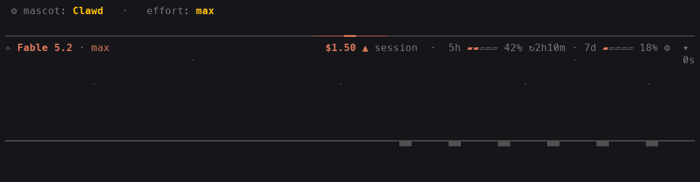
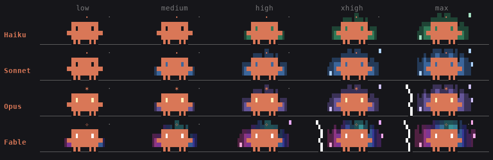
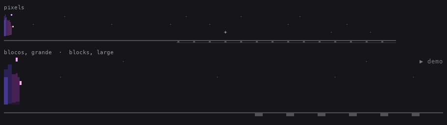

# legends-claude

**English** · [Português](README.pt-BR.md)

A bar above the Claude Code prompt that shows what matters while you work: **model and effort**, **session and turn cost**, **usage limits**, **every running agent**, and a **stage** where the Claude Code mascot builds, brick by brick, what the turn is doing. The mascot changes with the **model** and the **effort**: the stronger the model and the higher the effort, the more it glows. It does not show a context bar.



The bar spans the full width of the terminal. On a narrow terminal, model, cost and limits stack on lines of their own.

## What it shows

| Line | What it shows |
| --- | --- |
| Rule | The top line. While there is work in progress, a `━` pulse starts at the center and runs to both ends: wider and faster the higher the effort. |
| Header | Model and effort of the last request, both **clickable** (see Usage). The spark is the one of the model's class (`✢` Haiku, `✻` Sonnet, `❋` Opus, `❂` Fable; see Power): it pulses while the turn runs and stays dim when idle. Cost and limits sit at the right end of the same line when they fit. |
| Cost | Session total (the same sum `/cost` gives, subagents included) and how much was spent since the last prompt. Two decimal places (`$1.75`). The total lights up with `▲` for a moment whenever it grows. |
| Limits | The 5-hour and 7-day windows, with the time left until each resets. Only shown on accounts that report a limit. |
| Stage | Four lines of scene (eight at the large size), while a turn or an agent is running: in real pixels, in terminal blocks, in vector or in text, whichever the screen can show. See below. |
| Work | With the stage off: a comet of sparks `✳✶✻·····`, elapsed time, how many tools were called and the last one. With the stage on, this information moves to the scoreboard in its corner. |
| Agents | One line per subagent, teammate or workflow agent: the name emerges from a handful of sparks that settle letter by letter; then the pulsing spark of its model's class (in the color of its helper on the stage), a shimmer over the name and a comet of its own, each out of phase with its neighbor; elapsed time, tools and the last call. When it finishes it becomes `✓` with a burst of sparks that thins out, duration and tokens (or `✗` if it failed), and leaves after 8 seconds. Up to 6 lines by default (3, 6 or 10 in the settings tab); the rest becomes `+N agents`. |

## The stage

The stage is not a looping drawing: it reacts to what is actually happening.

- **The mascot** is the one from the Claude Code logo (`▐▛███▜▌` / `▝▜█████▛▘` / `▘▘ ▝▝`), dot for dot. It walks in from the left when the turn starts and waits in the middle of the lane.
- **Thinking or waiting.** While the model thinks, the spark of its class pulses over its head and its eyes move from side to side. While a tool runs, the tool's name appears (`Bash···`) and it raises and lowers its claws.
- **Every tool is a brick.** A tool call becomes a brick on the pile at the left, in the color of its family. The mascot fetches it, carries it on its head (up to six per trip; with a big pile it picks up the pace), puts it on the conveyor belt, and the belt takes it to the **wall** growing at the right, in alternating courses. The brick that just arrived lights up. The wall stays from one turn to the next: it is the picture of what the session did.
- **Helpers.** When Claude starts a subagent, the mascot stops, shouts `!`, and a smaller helper pops up behind it in a cloud of sparks, in the agent's color (the same as its spark in the list). The helper carries the bricks of its own agent's tools. Agent waiting: the helper sits down and sleeps (`z`). Agent finished: it jumps, gets a `✓` and vanishes in sparks; if it failed, it dims and gets a `✗`. Up to six helpers on stage.
- **The end.** When the turn ends with an answer, the mascot celebrates: with three tools or more, jumps and confetti in the colors of the bricks; on a short turn, just a little hop. A turn that was interrupted or ended in an error gets no party: the scene simply packs up.
- **The scoreboard** in the top right corner shows the turn's elapsed time, how many tools it called and the last one. Where the stage is an image it has no room for text: the scoreboard is the work line, right below it.

The brick colors:

| Color | Family | Examples |
| --- | --- | --- |
| blue | read | `Read`, `NotebookRead` |
| lilac | search | `Grep`, `Glob`, `ToolSearch` |
| green | edit and write | `Edit`, `Write`, `NotebookEdit` |
| amber | shell | `Bash`, `KillShell` |
| cyan | web | `WebFetch`, `WebSearch` |
| pink | agents | `Agent`, `Task`, `SendMessage` |
| orange | MCP tools | `mcp__server__tool` |
| gray | everything else | `TodoWrite`, `Skill`, `AskUserQuestion` |

To see the stage without waiting for a turn: `/legends-claude demo` (or the **▶ demo** button in the settings tab) plays a make-believe turn of about 25 seconds, with helpers and confetti.

## Power: model and effort

The mascot is not always the same. The **class of the model** decides who it is; the **effort** of the request, how much energy it gives off.



| Class | Spark | Aura | What else |
| --- | --- | --- | --- |
| Haiku | `✢` | green, from `high` up | the usual mascot |
| Sonnet | `✻`, Claude Code's own | blue, from `medium` up | a band of light crosses its body from time to time |
| Opus | `❋` | purple, from `medium` up | eyes lit in gold; a golden band, wider and more frequent; lightning at `max`; golden fireworks at the end-of-turn party |
| Fable | `❂` | shifting colors (cyan to pink, always moving), already at `low` | eyes lit in white; a shifting sheen that has barely passed before it starts again; it **flies** instead of walking (no legs, jets underneath); lightning from `xhigh` up; fireworks in every color |

- **The spark** of each class is the one in the header, in the agent lines and the one pulsing over the head of whoever is thinking: from Haiku's little dot to Fable's seal. A model of an unknown family gets Sonnet's.
- **Effort makes the aura grow.** At `low` there is none; at `medium`, a low glow around the body; from there up, each level widens the glow and raises the flames, which move every frame. From `high` up, whoever runs leaves streaks in the air behind (from Sonnet up only); from `xhigh` up, sparks rise along the sides. On Fable everything starts one level earlier; on Haiku, one later. The rule's pulse follows along: wider and faster.
- **The eyes** of the mascot are two holes: with an aura, it shows through them. From Opus up they have a light of their own.
- **Each helper has the power of its agent**: the model and the effort it runs with. A helper's aura is smaller than the mascot's; asleep or after failing, it has none.
- **Outside a turn**, when only the helpers are still working, the mascot rests: it keeps the eyes and the sheen of its class, without the energy of the effort.
- **On a light theme** the aura fades towards white instead of dark; lightning takes the theme's text color.
- Power is drawing only: it does not change what the stage tells (every tool is still a brick) nor anyone's speed.

To see a combination without switching models: `/legends-claude demo opus max` plays the demo with that look (a model, an effort, or both; a word that is neither is refused with a notice). In the demo, one helper is a Sonnet at `high` and the other a Haiku at `max`.

How the text stage is drawn: every terminal cell counts as 2×2 "subpixels", drawn with the quadrant block characters (`▘▝▖▗▀▄▌▐…`), and the background color allows two colors in the same cell. That is why the mascot walks half a cell at a time and jumps half a line at a time. The other ways of drawing it are in [Resolution](#resolution-pixels-blocks-vector-or-text). The scene is a pure simulation, frame by frame, with no randomness: the same state always draws the same frame.

The animation only runs while there is something to show (a turn, an agent, the demo, or the scene winding down: a brick on the belt, confetti falling). When idle, the bar does not redraw and costs nothing.

## Resolution: pixels, blocks, vector or text

The stage is one scene drawn four ways. The bar picks the best one the screen can show (the **resolution** setting, `auto` by default) and the settings tab says which one is in use.



| Drawn as | Where | What you get |
| --- | --- | --- |
| **pixels** | a terminal that draws images: kitty, Ghostty, iTerm2 3.5 or later with Claude Code's fullscreen rendering (inside tmux too, with `allow-passthrough` and `focus-events` on) | The scene as a real image, 8×16 pixels for each cell: bricks with relief, a slanted band of light crossing the body, flames you can see through, particles a few pixels wide, and pixel icons over the heads (the spark of whoever is thinking, an icon for the family of the tool in progress, `!`, `✓`, `✗`, `z`). |
| **blocks** | every other terminal | A grid of terminal cells. Each cell takes the block that comes closest to its pixels (`▁▂▃▄▅▆▇`, `▏▎▍▌▋▊▉`, the halves, the quadrants) and two colors, so the flames end at any eighth of a cell. The signs, the scoreboard, the floor and the stars stay as text. |
| **vector** | the desktop app | The same drawing as an SVG. |
| **text** | the `classic` resolution, or a Claude Code version without the new elements | The stage as it always was: quadrant characters, 2×2 "subpixels" for each cell. |

- **Smoother motion.** In pixels and in blocks the stage is repainted in place between two frames of the simulation, about 25 times a second, while the bar itself still redraws 8 times a second: the creatures glide from where they were to where they are going, the bricks roll along the belt and the sparks fly, instead of jumping. In blocks a creature moves half a cell at a time, the finest step a block can draw against the terminal's own background.
- **How the bar finds out.** In a terminal, the first drawing carries a transparent one-pixel image in a corner and asks Claude Code to repaint it: the answer says whether the terminal draws images. Until it arrives (a fraction of a second) the stage is in blocks. If images stop working halfway (a tmux without passthrough, say), the stage goes back to blocks by itself.
- **Size.** `large` doubles the stage (eight lines) and gives its world half the width of the bar, so each block shows more: in blocks, the relief of the bricks, the volume of the body, the slanted band of light and the floor line appear, as they do in pixels. It needs a terminal at least 118 columns wide and 11 free lines in the band; without that the stage stays at the usual size and the settings tab says so. It has no effect on the text stage.
- An image carries no text: in pixels and in vector the scoreboard goes back to the work line, right below the stage.
- To keep the stage exactly as it was before version 0.9, pick `classic`. To ask the terminal again whether it draws images (after turning tmux's passthrough on, say), pick `auto` again.

## Installation

At the prompt of a Claude Code session in the terminal:

```
/plugin install legends-claude --marketplace leolegends/legends-claude
```

Or straight from the shell:

```
claude plugin install legends-claude --marketplace leolegends/legends-claude
```

Claude Code asks `Add marketplace?` (answer `y`) and then the scope: choose **user** for the bar to apply to every session. It starts working right away, with no restart.

In the desktop app, where `/plugin` does not run: click **+** next to the prompt, then **Plugins**, **Add marketplace** with `leolegends/legends-claude`, and **Add plugin**.

To update: `claude plugin update legends-claude` and then `/reload-plugins`.
To remove: `claude plugin uninstall legends-claude`.

## Usage

- **Click the model** (`Fable 5.2`) to open a picker in the bar itself: `model  ● Fable  Opus  Sonnet  Haiku  ✕`. Clicking one runs `/model <name>`, as if you had typed it: the change is the session's and, like every `/model`, it is saved as the default for the next ones.
- **Click the effort** (`high`) to open `effort  low  medium  ● high  xhigh  max  ✕`, which runs `/effort <level>`.
- In the middle of a turn the change is queued and applies when the turn ends. `✕` (or clicking the model/effort again) closes the picker without changing anything.
- `▾` at the corner of the bar hides it; `◂ status` brings it back. `/legends-claude` toggles between hidden and visible.
- `/legends-claude demo` plays the stage, with the session idle. `/legends-claude demo fable max` plays it as another model and effort, without changing the session's.
- **`⚙` opens the settings tab** in the bar itself (or `/legends-claude settings`; `ajustes` works too). Every change applies immediately and is saved for the next sessions:

```
⚙ settings                                                   ▶ demo   restore defaults   ✕
language     Português  ● English
color        ● Claude  Blue  Green  Purple  Pink  Cyan  Amber  Mono
animation    ● full  subtle  still
speed        slow  ● normal  fast
resolution   ● auto  blocks  classic    in use: blocks
size         ● normal  large
show         ☑ rule  ☑ stage  ☑ limits  ☑ turn cost
agents       3  ● 6  10
```

| Setting | What it does |
| --- | --- |
| language | English or Portuguese: switches every text in the bar, the notices and the command's description at once. With no saved choice, a fresh install follows the system language (`LC_ALL`, `LC_MESSAGES`, `LANG`): Portuguese if it says `pt`, English otherwise. "Restore defaults" leaves the language alone. |
| color | The accent color: the mascot, the spark, the model, the comet, the rule's pulse, the lit-up cost. Each option is already shown in its own color. `Claude` and `Mono` follow Claude Code's light/dark theme. |
| animation | `full` is everything, stage included; `subtle` keeps only the pulsing spark and the comet (no stage, rule pulse, emerging name, shimmer or burst); `still` moves nothing and only updates the time once a second. |
| speed | The duration of a frame: 200, 125 or 80 ms. It is also the pace of the stage. No effect while the animation is still. |
| resolution | What the stage is drawn in. `auto` is the best the screen offers: real pixels in a terminal that draws images, terminal blocks in the others, vector in the desktop app. `blocks` keeps the blocks even where there are pixels. `classic` is the text stage. Next to the options, the tab says what is in use on this screen. |
| size | `normal` is the four-line stage; `large` doubles it (see [Resolution](#resolution-pixels-blocks-vector-or-text)). It only applies outside the text stage, and where the bar has room. |
| show | Turns the top rule, the stage, the 5h/7d limits and the turn cost on and off. The stage only appears with the `full` animation. |
| agents | How many agent lines appear before the `+N agents` summary. |

## Requirements and limits

- Claude Code with mod support (function hooks). Written and tested on version 2.1.322. This API is in early access and may change between versions.
- The bar needs a terminal at least 60 columns wide; below that it does not draw. On a bar wider than 120 columns the stage does not stretch past that.
- The band above the prompt may take up to half the terminal's height. If the stage does not fit (fewer than 7 free lines) it stays out and the work line comes back; if it only just fits, it is the agent list that shrinks to `+N agents`.
- The stage in pixels needs a terminal that draws images (the kitty graphics protocol with placeholders, or iTerm2's inline images) and a Claude Code version with the `Image`, `Raster` and `$.ui.blit` pieces of the mod API. Where one of them is missing the bar falls back by itself: to blocks, and from blocks to text.
- The stage in blocks and in text uses the Block Elements characters (`▀▄█▌▐`, the eighths, the quadrants) and 24-bit color. On a terminal without 24-bit color the brick and aura colors are approximated; in a font without those blocks the drawing does not close up.
- In pixels, in blocks and in vector the colors are painted as RGB, not as theme colors: the ones that come from Claude Code's theme (the mascot's `Claude` accent, the helpers' colors, the floor) are close approximations for the light and the dark theme.
- Repainting the stage between frames costs one to three milliseconds each time (measured outside Claude Code), and only while the scene is moving and the stage is on screen.
- The spark of each class uses glyphs from the Dingbats block (`✢ ✣ ✤`, `✸ ✹ ✺ ❋`, `✧ ✦ ✪ ❂ ❉`), like Claude Code's own; in a font missing one of them the terminal shows its replacement.
- The aura fades towards the terminal's background, and the mod only knows whether the theme is light or dark from its name (the `theme` row of `/config`): a theme whose name does not say `light` counts as dark.
- Per-agent cost is not shown: Claude Code only exposes the session's total cost. Per agent, the bar shows the tokens of its last turn.
- The effort appears from the first model request after the plugin loads; until then the bar shows `effort`, already clickable.
- The model picker uses the aliases `fable`, `opus`, `sonnet` and `haiku`; a model your account does not have is refused by `/model` itself, and the bar says so.
- The plugin accesses neither the network nor files. It reads the session's usage, the agent list and the theme (the `theme` row of `/config`, and its changes), keeps its state in the session and its settings in the plugin's own store (a JSON file in Claude Code's configuration folder), and reads three environment variables (`LC_ALL`, `LC_MESSAGES`, `LANG`) to pick the first language. The stage's scene lives in memory only and starts over with each session or `/reload-plugins`.
- The stage is decoration: an error in it becomes an empty scene and one notice line; it never gets in the way of a tool or takes the bar down.
- The `⚙` icon is drawn as text in most terminals; in a terminal that shows it as a wide emoji, the first line may lose a column at the right.

## Development

```
claude plugin validate .
claude plugin test .
claude --plugin-dir .        # runs a session with the plugin loaded from this folder
```

The hooks module and what it imports, in `hooks/`:

- `register.tsx`: the events, the state, the animation clock and the drawing of the bar.
- `lines.ts`: the lines of the bar (header, cost, work, limits, agents), pure.
- `effects.ts`: the text animations (spark, comet, rule pulse, emerging name, burst, shimmer).
- `format.ts`, `parts.ts`, `agents.ts`: text formats, line parts, and the agent lines reconciled with the engine's list.
- `sim.ts`: the stage simulation, pure: the state and the functions that give the next state.
- `scene.ts`: the drawing of one frame of the scene as text (bubbles, bricks, belt, stars). `pose.ts`: what each creature is doing in a frame, shared by the text stage and the pixel one.
- `hd.ts`, `hd-aura.ts`, `hd-art.ts`: the same scene in pixels, between two frames of the simulation: a list of rectangles of paint, with the aura, the particles and the small drawings (bricks with relief, icons, floor).
- `canvas.ts`, `png.ts`, `blocks.ts`, `vector.ts`: from the rectangles to a frame of pixels, to a PNG (the mod has no zlib: the encoder is its own), to terminal cells (the block and the two colors that come closest to each cell) and to SVG.
- `stage.ts`, `stage-node.tsx`, `painter.ts`: which way the stage is drawn on each screen, its element (`Image`, `Raster` or `Svg`), and the clock that repaints it between frames and asks the terminal whether it draws images.
- `power.ts`: the power of whoever is working: the model's class, the effort's step, the aura's strength and the spark of each class.
- `aura.ts`: the look of a creature with power, pure: the aura, the body's sheen, the eyes, the sparks, the lightning, the jets and the fireworks.
- `pixels.ts`, `sprites.ts`, `palette.ts`, `color.ts`: the subpixel renderer (with the glow behind the scene), the creatures' drawings, the colors and the color math.
- `demo.ts`: the script of the demo.
- `i18n.ts`: the bar's texts in Portuguese and in English. A new text goes into the `Strings` type and the compiler demands its translation in both.
- `settings.ts`, `settings-panel.tsx`: the settings and their tab.
- `types/index.d.ts` (at the root): the contract of the state the plugin keeps.

The code comments and the test names are in Portuguese, the language the project was born in.

The tests (`*.test.ts`, 383 in all) cover the pure functions, the simulation frame by frame, the drawing of the scene, the power of each class, the PNG encoder and the fit to blocks, and the bar mounted on each surface, in text, in blocks, in pixels and in vector.

The GIFs of the two READMEs come out of the same functions that draw the bar, outside Claude Code (needs `bun` and Pillow). The make-believe turn runs with the model and the effort asked for (the default is `fable high`), with the stage in blocks, as most terminals show it (add `texto` at the end for the text stage); the power table is the same in both languages:

```
bun run scripts/demo-frames.ts 100 en fable max | python3 scripts/demo-gif.py docs/demo.gif
bun run scripts/demo-frames.ts 100 pt fable max | python3 scripts/demo-gif.py docs/demo.pt-BR.gif
bun run scripts/power-frames.ts | python3 scripts/demo-gif.py docs/power.gif
```

The GIF of the pixel stage is made of the stage alone, in two strips that run together (the frame files are large: keep them out of the repository):

```
bun run scripts/stage-frames.ts /tmp/pixels.bin 100 pixels normal fable max
bun run scripts/stage-frames.ts /tmp/large.bin 112 blocos grande fable max
python3 scripts/stage-gif.py docs/stage.gif "pixels=/tmp/pixels.bin" "blocos, grande  ·  blocks, large=/tmp/large.bin"
```

The documentation has two files that change together: `README.md` (English) and `README.pt-BR.md` (Portuguese).

## Credits and license

MIT. Some helper functions were adapted from [claude-statuspane](https://github.com/xuanji86/claude-statuspane) (MIT), by Anji Xu. The idea of drawing the mascot with the screen's own picture elements, instead of characters only, came from [claud-in](https://github.com/two2dope/claud-in), by two2Dope, whose mascot is an SVG in the desktop app. The animations follow techniques from the `ascii-animations` skill (character grid, state machines, wave propagation, particles), adapted to the terminal.
