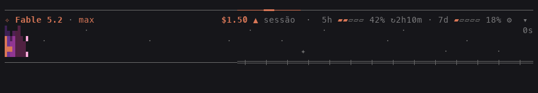
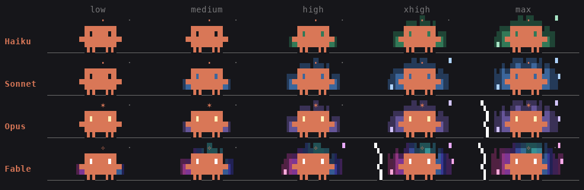
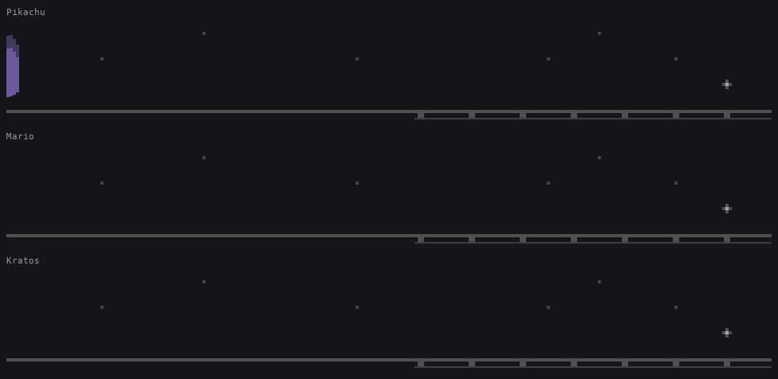
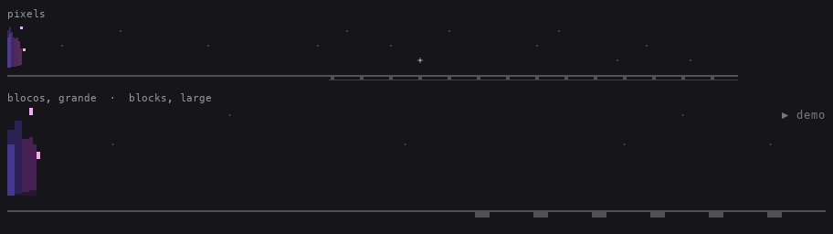

# legends-claude

[English](README.md) · **Português**

Uma barra acima do prompt do Claude Code que mostra o que importa enquanto você trabalha: **modelo e effort**, **custo da sessão e do turno**, **limites de uso**, **cada agente em execução** e um **palco** onde o mascote do Claude Code constrói, tijolo por tijolo, o que o turno está fazendo. O mascote muda com o **modelo** e com o **effort**: quanto mais forte o modelo e mais alto o effort, mais ele brilha. Não mostra barra de contexto.



A barra ocupa a largura toda do terminal. Num terminal estreito, modelo, custo e limites empilham em linhas próprias.

## O que aparece

| Linha | O que mostra |
| --- | --- |
| Régua | A linha de cima. Com trabalho em curso, um pulso `━` nasce no centro e corre para as duas pontas: mais largo e mais rápido quanto maior o effort. |
| Cabeçalho | Modelo e effort do último pedido, **clicáveis** (veja Uso). A faísca é a da classe do modelo (`✢` Haiku, `✻` Sonnet, `❋` Opus, `❂` Fable; veja O poder): pulsa enquanto o turno roda e fica apagada quando está ocioso. Custo e limites encostam à direita na mesma linha quando cabem. |
| Custo | Total da sessão (o mesmo que `/cost` soma, subagentes incluídos) e quanto foi gasto desde o último prompt. Duas casas decimais (`$1.75`). O total acende com `▲` por um instante sempre que cresce. |
| Limites | Janelas de 5 horas e 7 dias, com quanto falta para zerar. Só aparece em contas que reportam limite. |
| Palco | Quatro linhas de cena (oito no tamanho grande), enquanto há um turno ou um agente rodando: em pixels de verdade, em blocos de terminal, em vetor ou em texto, o que a tela conseguir mostrar. Veja abaixo. |
| Trabalho | Com o palco desligado: um cometa de faíscas `✳✶✻·····`, tempo decorrido, quantas ferramentas foram chamadas e a última delas. Com o palco ligado, essas informações ficam no placar do canto dele. |
| Agentes | Uma linha por subagente, teammate ou agente de workflow: o nome surge de um punhado de faíscas que assentam letra a letra; depois, a faísca da classe do modelo dele pulsando (na cor do ajudante dele no palco), brilho no nome e um cometa próprio, cada um fora de fase do vizinho; tempo, ferramentas e a última chamada. Ao terminar vira `✓` com um estouro de faíscas que rareia, duração e tokens (ou `✗` se falhou) e some depois de 8 segundos. Por padrão no máximo 6 linhas (3, 6 ou 10 na aba de ajustes); o resto vira `+N agentes`. |

## O palco

O palco não é um desenho em loop: ele reage ao que está acontecendo de verdade.

- **O mascote** é o do logo do Claude Code (`▐▛███▜▌` / `▝▜█████▛▘` / `▘▘ ▝▝`), ponto a ponto. Ele entra pela esquerda quando o turno começa e espera no meio da pista.
- **Pensando ou esperando.** Enquanto o modelo pensa, a faísca da classe dele pulsa sobre a cabeça e os olhos vão de um lado para o outro. Enquanto uma ferramenta roda, aparece o nome dela (`Bash···`) e ele sobe e desce as garras.
- **Cada ferramenta é um tijolo.** Uma chamada de ferramenta vira um tijolo na pilha da esquerda, na cor da família dela. O mascote vai buscar, leva na cabeça (até seis por viagem; com a pilha grande ele aperta o passo), põe na esteira, e a esteira leva até a **parede** que cresce à direita, em fiadas alternadas. O tijolo recém-chegado acende. A parede fica de um turno para o outro: é o retrato do que a sessão fez.
- **Ajudantes.** Quando o Claude dispara um subagente, o mascote para, grita `!`, e um ajudante menor brota atrás dele numa nuvem de faíscas, na cor do agente (a mesma da faísca dele na lista). O ajudante carrega os tijolos das ferramentas do próprio agente. Agente à espera: o ajudante senta e dorme (`z`). Agente terminado: ele pula, ganha `✓` e some em faíscas; se falhou, apaga e leva `✗`. Até seis ajudantes em cena.
- **O fim.** Quando o turno termina com uma resposta, o mascote comemora: com três ferramentas ou mais, pulos e confete nas cores dos tijolos; num turno curto, só um pulinho. Um turno interrompido ou que acabou em erro não tem festa: a cena se recolhe.
- **O placar** no canto de cima à direita mostra o tempo do turno, quantas ferramentas ele chamou e a última delas. Onde o palco é uma imagem não há lugar para texto: o placar é a linha de trabalho, logo abaixo dele.

As cores dos tijolos:

| Cor | Família | Exemplos |
| --- | --- | --- |
| azul | ler | `Read`, `NotebookRead` |
| lilás | buscar | `Grep`, `Glob`, `ToolSearch` |
| verde | editar e escrever | `Edit`, `Write`, `NotebookEdit` |
| âmbar | shell | `Bash`, `KillShell` |
| ciano | web | `WebFetch`, `WebSearch` |
| rosa | agentes | `Agent`, `Task`, `SendMessage` |
| laranja | ferramentas MCP | `mcp__servidor__ferramenta` |
| cinza | o resto | `TodoWrite`, `Skill`, `AskUserQuestion` |

Para ver o palco sem esperar um turno: `/legends-claude demo` (ou o botão **▶ demonstração** na aba de ajustes) roda um turno de mentira de uns 25 segundos, com ajudantes e confete.

## O poder: modelo e effort

O mascote não é sempre o mesmo. A **classe do modelo** decide quem ele é; o **effort** do pedido, quanta energia ele solta.



| Classe | Faísca | Aura | O que mais |
| --- | --- | --- | --- |
| Haiku | `✢` | verde, a partir de `high` | o mascote de sempre |
| Sonnet | `✻`, a do Claude Code | azul, a partir de `medium` | uma faixa de luz atravessa o corpo de tempos em tempos |
| Opus | `❋` | roxa, a partir de `medium` | olhos acesos em ouro; faixa dourada, mais larga e mais frequente; raios em `max`; fogos de ouro na festa do fim |
| Fable | `❂` | furta-cor (do ciano ao rosa, correndo), já em `low` | olhos acesos em branco; brilho furta-cor que mal passa e já recomeça; **voa** em vez de andar (sem patas, com jatos por baixo); raios a partir de `xhigh`; fogos de todas as cores |

- **A faísca** de cada classe é a do cabeçalho, a das linhas de agente e a que pulsa sobre a cabeça de quem pensa: do pontinho de Haiku ao selo de Fable. Um modelo de família desconhecida fica com a de Sonnet.
- **O effort faz a aura crescer.** Em `low` não há nenhuma; em `medium`, um clarão baixo em volta do corpo; daí para cima, cada nível alarga o clarão e sobe as labaredas, que se mexem a cada quadro. De `high` para cima, quem corre risca o ar atrás de si (só de Sonnet para cima); de `xhigh` para cima, sobem fagulhas pelos lados. Em Fable tudo começa um nível antes; em Haiku, um depois. O pulso da régua acompanha: mais largo e mais rápido.
- **Os olhos** do mascote são dois vazios: com aura, ela aparece através deles. De Opus para cima eles têm luz própria.
- **Cada ajudante tem o poder do seu agente**: o modelo e o effort com que ele roda. A aura de um ajudante é menor que a do mascote; dormindo ou depois de falhar, ele fica sem nenhuma.
- **Fora de um turno**, quando só os ajudantes ainda trabalham, o mascote descansa: segue com os olhos e o brilho da classe, sem a energia do effort.
- **Num tema claro** a aura clareia em direção ao branco, em vez de escurecer; os raios têm a cor do texto do tema.
- O poder é só desenho: não muda o que o palco conta (cada ferramenta segue sendo um tijolo) nem a velocidade de ninguém.

Para ver uma combinação sem trocar de modelo: `/legends-claude demo opus max` roda a demonstração com essa aparência (um modelo, um effort, ou os dois; uma palavra que não é nem um nem outro é recusada com um aviso). Na demonstração, um ajudante é um Sonnet em `high` e o outro um Haiku em `max`.

Como o palco de texto é desenhado: cada célula do terminal vale 2×2 "subpixels", desenhados com os blocos de quadrante (`▘▝▖▗▀▄▌▐…`), e a cor de fundo permite duas cores na mesma célula. Por isso o mascote anda de meia em meia célula e pula de meia em meia linha. Os outros jeitos de desenhá-lo estão em [Resolução](#resolução-pixels-blocos-vetor-ou-texto). A cena é uma simulação pura, quadro a quadro, sem sorteio: o mesmo estado desenha sempre o mesmo quadro.

A animação só roda enquanto há o que mostrar (um turno, um agente, a demonstração, ou a cena terminando: um tijolo na esteira, o confete caindo). Parada, a barra não redesenha e não gasta nada.

## Mascotes: Clawd, Pikachu, Mario e Kratos



Quem é o mascote no palco se escolhe na aba de ajustes (`⚙`), na linha `mascote`. A troca vale na hora e fica salva.

| Mascote | Como é |
| --- | --- |
| Clawd | O de sempre, o do logo do Claude Code, de uma cor só: a cor de destaque dos ajustes. |
| Pikachu | Amarelo, de orelhas de ponta escura, bochechas vermelhas e o rabo em raio. |
| Mario | Boné e camisa vermelhos, bigode, macacão azul de botões amarelos, luvas brancas. |
| Kratos | Pele de cinza, a faixa vermelha sobre o olho, barba, ombreira dourada e saiote de couro. |

- **Dois desenhos por avatar colorido.** O fino (36×20 pontos) aparece onde há detalhe: em pixels, em vetor e em blocos no tamanho `grande`. Em blocos no tamanho `normal` e no palco de texto vai uma versão de baixa resolução (18×5), bem mais simples: é o que cabe em blocos de quadrante com duas cores por célula.
- **Tudo o que o Clawd faz, eles fazem.** Piscam, olham para os lados quando pensam, levantam os braços para carregar e comemorar, andam, sentam para dormir, apagam quando falham.
- **O poder vale para todos.** A aura, os riscos, as fagulhas, os raios, o voo de Fable e os fogos saem do modelo e do effort, como no Clawd. De Opus para cima são as pupilas que acendem. A faixa de brilho é mais leve sobre um avatar colorido, para ele seguir aparecendo por baixo dela.
- **As cores são deles.** A cor de destaque dos ajustes não pinta um avatar colorido; segue valendo no resto da barra (a faísca, o modelo, o cometa, a régua).
- **Os ajudantes não mudam**: seguem sendo os pequenos Clawds, cada um na cor do seu agente.
- A escolha é só desenho: todos têm a largura e a cabeça do Clawd, então o palco conta a mesma história com qualquer um (onde ele para, quantos tijolos carrega).

Pikachu, Mario e Kratos são personagens e marcas dos seus donos (Nintendo / The Pokémon Company e Sony Interactive Entertainment). Os desenhos daqui são pixel art feita por fãs, sem vínculo com essas empresas nem endosso delas.

## Resolução: pixels, blocos, vetor ou texto

O palco é uma cena só, desenhada de quatro jeitos. A barra escolhe o melhor que a tela consegue mostrar (o ajuste **resolução**, `automática` por padrão) e a aba de ajustes diz qual está em uso.



| Sai em | Onde | O que se vê |
| --- | --- | --- |
| **pixels** | um terminal que desenha imagens: kitty, Ghostty, iTerm2 3.5 ou mais novo com a renderização em tela cheia do Claude Code (dentro do tmux também, com `allow-passthrough` e `focus-events` ligados) | A cena como uma imagem de verdade, 8×16 pixels para cada célula: tijolos com relevo, uma faixa de luz inclinada cruzando o corpo, chamas que deixam ver o fundo, partículas de poucos pixels, e ícones em pixels sobre as cabeças (a faísca de quem pensa, um ícone para a família da ferramenta em curso, `!`, `✓`, `✗`, `z`). |
| **blocos** | qualquer outro terminal | Uma grade de células do terminal. Cada célula fica com o bloco que mais se aproxima dos pixels dela (`▁▂▃▄▅▆▇`, `▏▎▍▌▋▊▉`, as metades, os quadrantes) e duas cores: as chamas terminam em qualquer oitavo de célula. Os sinais, o placar, o chão e as estrelas seguem como texto. |
| **vetor** | o app desktop | O mesmo desenho, em SVG. |
| **texto** | a resolução `clássica`, ou uma versão do Claude Code sem os elementos novos | O palco de sempre: caracteres de quadrante, 2×2 "subpixels" para cada célula. |

- **Movimento mais suave.** Em pixels e em blocos o palco é repintado no lugar entre dois quadros da simulação, perto de 25 vezes por segundo, enquanto a barra segue sendo redesenhada 8 vezes por segundo: os bichos deslizam de onde estavam para onde vão, os tijolos correm na esteira e as faíscas voam, em vez de pular. Em blocos um bicho anda de meia em meia célula, o menor passo que um bloco desenha sobre o fundo do próprio terminal.
- **Como a barra descobre.** Num terminal, o primeiro desenho leva uma imagem transparente de um pixel num canto e pede ao Claude Code que a repinte: a resposta diz se o terminal desenha imagens. Até ela chegar (uma fração de segundo) o palco fica em blocos. Se as imagens param de funcionar no meio do caminho (um tmux sem passthrough, por exemplo), o palco volta sozinho aos blocos.
- **Tamanho.** `grande` dobra o palco (oito linhas) e dá ao mundo dele a metade da largura da barra, então cada bloco mostra mais: em blocos aparecem o relevo dos tijolos, o volume do corpo, a faixa de luz inclinada e a linha do chão, como em pixels. Precisa de um terminal com pelo menos 118 colunas e de 11 linhas livres na faixa; sem isso o palco fica no tamanho de sempre e a aba de ajustes avisa. Não tem efeito no palco de texto.
- Uma imagem não leva texto: em pixels e em vetor o placar volta para a linha de trabalho, logo abaixo do palco.
- Para manter o palco exatamente como era antes da versão 0.9, escolha `clássica`. Para perguntar de novo ao terminal se ele desenha imagens (depois de ligar o passthrough do tmux, por exemplo), escolha `automática` outra vez.

## Instalação

No prompt de uma sessão do Claude Code no terminal:

```
/plugin install legends-claude --marketplace leolegends/legends-claude
```

Ou direto do shell:

```
claude plugin install legends-claude --marketplace leolegends/legends-claude
```

O Claude Code pergunta `Add marketplace?` (responda `y`) e depois o escopo: escolha **user** para a barra valer em todas as sessões. Ele passa a funcionar na hora, sem reiniciar.

No app desktop, onde `/plugin` não roda: clique em **+** ao lado do prompt, depois **Plugins**, **Add marketplace** com `leolegends/legends-claude` e **Add plugin**.

Para atualizar: `claude plugin update legends-claude` e depois `/reload-plugins`.
Para remover: `claude plugin uninstall legends-claude`.

## Uso

- **Clique no modelo** (`Fable 5.2`) abre um seletor na própria barra: `modelo  ● Fable  Opus  Sonnet  Haiku  ✕`. Clicar num deles roda `/model <nome>`, como se você tivesse digitado: a troca é a da sessão e, como todo `/model`, fica salva como padrão das próximas.
- **Clique no effort** (`high`) abre `effort  low  medium  ● high  xhigh  max  ✕` e roda `/effort <nível>`.
- No meio de um turno a troca entra na fila e vale quando o turno termina. `✕` (ou clicar de novo no modelo/effort) fecha o seletor sem trocar nada.
- `▾` no canto da barra esconde; `◂ status` traz de volta. `/legends-claude` alterna entre escondido e visível.
- `/legends-claude demo` mostra o palco em ação, com a sessão parada. `/legends-claude demo fable max` mostra com outro modelo e effort, sem trocar os da sessão.
- **`⚙` abre a aba de ajustes** na própria barra (ou `/legends-claude ajustes`; `settings` também serve). Cada mudança vale na hora e fica salva para as próximas sessões:

```
⚙ ajustes                                          ▶ demonstração   restaurar padrão   ✕
idioma       ● Português  English
cor          ● Claude  Azul  Verde  Roxo  Rosa  Ciano  Âmbar  Mono
mascote      ● Clawd  Pikachu  Mario  Kratos
animação     ● completa  suave  parada
velocidade   lenta  ● normal  rápida
resolução    ● automática  blocos  clássica    em uso: blocos
tamanho      ● normal  grande
mostrar      ☑ régua  ☑ palco  ☑ limites  ☑ custo do turno
agentes      3  ● 6  10
```

| Ajuste | O que faz |
| --- | --- |
| idioma | Português ou inglês: muda na hora todos os textos da barra, os avisos e a descrição do comando. Sem uma escolha salva, uma instalação nova segue o idioma do sistema (`LC_ALL`, `LC_MESSAGES`, `LANG`): português se ele disser `pt`, senão inglês. "Restaurar padrão" não mexe no idioma. |
| cor | A cor de destaque: o mascote, a faísca, o modelo, o cometa, o pulso da régua, o custo aceso. Cada opção já aparece na própria cor. `Claude` e `Mono` seguem o tema claro/escuro do Claude Code. |
| mascote | Quem é o mascote no palco. `Clawd` é o de sempre, na cor de destaque. `Pikachu`, `Mario` e `Kratos` são avatares coloridos, com cores próprias (a cor de destaque segue valendo no resto da barra): em pixels, em vetor e em blocos no tamanho grande aparecem no desenho fino; em blocos no tamanho normal e no palco de texto, numa versão de baixa resolução. O poder (aura, brilho, olhos acesos, voo) vale para todos; os ajudantes seguem sendo os pequenos Clawds. |
| animação | `completa` é tudo, palco incluído; `suave` deixa só a faísca pulsando e o cometa (sem palco, pulso na régua, nome surgindo, brilho nem estouro); `parada` não mexe nada e só atualiza o tempo uma vez por segundo. |
| velocidade | A duração de um quadro: 200, 125 ou 80 ms. É também o ritmo do palco. Sem efeito com a animação parada. |
| resolução | Em que o palco é desenhado. `automática` é o melhor que a tela oferece: pixels de verdade num terminal que desenha imagens, blocos de terminal nos outros, vetor no app desktop. `blocos` mantém os blocos mesmo onde há pixels. `clássica` é o palco de texto. Ao lado das opções, a aba diz o que está em uso nesta tela. |
| tamanho | `normal` é o palco de quatro linhas; `grande` dobra o palco (veja [Resolução](#resolução-pixels-blocos-vetor-ou-texto)). Só vale fora do palco de texto, e onde a barra tem espaço. |
| mostrar | Liga e desliga a régua de cima, o palco, os limites de 5h/7d e o custo do turno. O palco só aparece com a animação `completa`. |
| agentes | Quantas linhas de agente aparecem antes do resumo `+N agentes`. |

## Requisitos e limites

- Claude Code com suporte a mods (function hooks). Escrito e testado na versão 2.1.322. Essa API está em acesso antecipado e pode mudar entre versões.
- A barra precisa de pelo menos 60 colunas de terminal; abaixo disso ela não desenha. Numa barra com mais de 120 colunas o palco não estica além disso.
- A faixa acima do prompt pode ocupar até metade da altura do terminal. Se o palco não couber (menos de 7 linhas livres) ele não entra e a linha de trabalho volta; se couber justo, é a lista de agentes que encolhe para `+N agentes`.
- O palco em pixels precisa de um terminal que desenhe imagens (o protocolo gráfico do kitty com placeholders, ou as imagens embutidas do iTerm2) e de uma versão do Claude Code com as peças `Image`, `Raster` e `$.ui.blit` da API de mods. Onde falta alguma delas a barra recua sozinha: para blocos, e de blocos para texto.
- O palco em blocos e em texto usa os caracteres de Block Elements (`▀▄█▌▐`, os oitavos, os quadrantes) e cor de 24 bits. Num terminal sem cor de 24 bits as cores dos tijolos e da aura são aproximadas; numa fonte sem esses blocos o desenho não fecha.
- Em pixels, em blocos e em vetor as cores são pintadas como RGB, não como cores do tema: as que vêm do tema do Claude Code (a cor `Claude` do mascote, as dos ajudantes, o chão) são aproximações próximas para o tema claro e para o escuro.
- Repintar o palco entre os quadros custa de um a três milissegundos por vez (medido fora do Claude Code), e só enquanto a cena se mexe e o palco está à vista.
- A faísca de cada classe usa glifos do bloco Dingbats (`✢ ✣ ✤`, `✸ ✹ ✺ ❋`, `✧ ✦ ✪ ❂ ❉`), como a do próprio Claude Code; numa fonte sem algum deles o terminal mostra o substituto dele.
- A aura esmaece para o fundo do terminal, e o mod só sabe se o tema é claro ou escuro pelo nome dele (a linha `theme` do `/config`): um tema cujo nome não diz `light` vale como escuro.
- O custo por agente não aparece: o Claude Code só expõe o custo total da sessão. Por agente, a barra mostra os tokens do último turno.
- O effort aparece a partir do primeiro pedido ao modelo depois que o plugin carrega; antes disso a barra mostra `effort`, já clicável.
- O seletor de modelo usa os apelidos `fable`, `opus`, `sonnet` e `haiku`; um modelo que a sua conta não tem é recusado pelo próprio `/model`, e a barra avisa.
- O plugin não acessa rede nem arquivos. Ele lê o uso da sessão, a lista de agentes e o tema (a linha `theme` do `/config`, e a troca dela), guarda o estado na sessão e os ajustes no store do próprio plugin (um JSON na pasta de configuração do Claude Code), e lê três variáveis de ambiente (`LC_ALL`, `LC_MESSAGES`, `LANG`) para escolher o primeiro idioma. A cena do palco vive só na memória e recomeça a cada sessão ou `/reload-plugins`.
- O palco é enfeite: um erro nele vira uma cena vazia e uma linha de aviso, nunca atrapalha uma ferramenta nem derruba a barra.
- O ícone `⚙` é desenhado como texto na maioria dos terminais; num terminal que o mostre como emoji largo, a primeira linha pode perder uma coluna à direita.

## Desenvolvimento

```
claude plugin validate .
claude plugin test .
claude --plugin-dir .        # roda uma sessão com o plugin carregado desta pasta
```

O módulo de hooks e o que ele importa, em `hooks/`:

- `register.tsx`: os eventos, o estado, o relógio da animação e o desenho da barra.
- `lines.ts`: as linhas da barra (cabeçalho, custo, trabalho, limites, agentes), puras.
- `effects.ts`: as animações de texto (faísca, cometa, pulso da régua, nome surgindo, estouro, brilho).
- `format.ts`, `parts.ts`, `agents.ts`: formatos de texto, trechos de linha, e as linhas de agente conferidas com a lista do engine.
- `sim.ts`: a simulação do palco, pura: o estado e as funções que dão o estado seguinte.
- `scene.ts`: o desenho de um quadro da cena em texto (balões, tijolos, esteira, estrelas). `pose.ts`: o que cada bicho está fazendo num quadro, usado pelo palco de texto e pelo de pixels.
- `hd.ts`, `hd-aura.ts`, `hd-art.ts`: a mesma cena em pixels, entre dois quadros da simulação: uma lista de retângulos de tinta, com a aura, as partículas e os desenhos miúdos (tijolos com relevo, ícones, chão).
- `canvas.ts`, `png.ts`, `blocks.ts`, `vector.ts`: dos retângulos a um quadro de pixels, a um PNG (o mod não tem zlib: o codificador é próprio), a células de terminal (o bloco e as duas cores que mais se aproximam de cada célula) e a SVG.
- `stage.ts`, `stage-node.tsx`, `painter.ts`: em que o palco sai em cada tela, o elemento dele (`Image`, `Raster` ou `Svg`), e o relógio que o repinta entre os quadros e pergunta ao terminal se ele desenha imagens.
- `power.ts`: o poder de quem trabalha: a classe do modelo, o degrau do effort, a força da aura e a faísca de cada classe.
- `aura.ts`: a aparência de um bicho com poder, pura: a aura, o brilho do corpo, os olhos, as fagulhas, os raios, os jatos e os fogos.
- `pixels.ts`, `sprites.ts`, `palette.ts`, `color.ts`: o desenhador de subpixels (com o clarão de fundo), os desenhos dos bichos, as cores e as contas de cor.
- `avatars.ts`: os avatares coloridos do mascote, como texto: a paleta de cada um, o desenho comum e o fino, com as posturas como remendos sobre ele. Um avatar novo é um desenho novo aqui, uma opção em `settings.ts` e um nome no tipo `StatusAvatar`.
- `demo.ts`: o roteiro da demonstração.
- `i18n.ts`: os textos da barra em português e em inglês. Um texto novo entra no tipo `Strings` e o compilador cobra a tradução nos dois.
- `settings.ts`, `settings-panel.tsx`: os ajustes e a aba deles.
- `types/index.d.ts` (na raiz): o contrato do estado que o plugin guarda.

Os comentários do código e os nomes dos testes estão em português, a língua em que o projeto nasceu.

Os testes (`*.test.ts`, 399 ao todo) cobrem as funções puras, a simulação quadro a quadro, o desenho da cena, o poder de cada classe, o codificador de PNG e o ajuste em blocos, e a barra montada em cada superfície, em texto, em blocos, em pixels e em vetor.

Os GIFs dos dois READMEs saem das mesmas funções que desenham a barra, fora do Claude Code (precisa de `bun` e de Pillow). O turno de mentira roda com o modelo e o effort pedidos (o padrão é `fable high`), com o palco em blocos, como a maioria dos terminais o mostra (`texto` no fim dá o palco de texto); a tabela de poderes é a mesma nos dois idiomas:

```
bun run scripts/demo-frames.ts 100 en fable max | python3 scripts/demo-gif.py docs/demo.gif
bun run scripts/demo-frames.ts 100 pt fable max | python3 scripts/demo-gif.py docs/demo.pt-BR.gif
bun run scripts/power-frames.ts | python3 scripts/demo-gif.py docs/power.gif
```

O GIF do palco em pixels é feito só do palco, em duas faixas que andam juntas (os arquivos de quadros são grandes: deixe-os fora do repositório):

```
bun run scripts/stage-frames.ts /tmp/pixels.bin 100 pixels normal fable max
bun run scripts/stage-frames.ts /tmp/grande.bin 112 blocos grande fable max
python3 scripts/stage-gif.py docs/stage.gif "pixels=/tmp/pixels.bin" "blocos, grande  ·  blocks, large=/tmp/grande.bin"
# o GIF dos mascotes: o último argumento de stage-frames.ts é o avatar
for a in pikachu mario kratos; do bun run scripts/stage-frames.ts /tmp/$a.bin 120 pixels grande opus high escuro $a; done
python3 scripts/stage-gif.py docs/avatars.gif "Pikachu=/tmp/pikachu.bin" "Mario=/tmp/mario.bin" "Kratos=/tmp/kratos.bin"
```

A documentação tem dois arquivos, que mudam juntos: `README.md` (inglês) e `README.pt-BR.md` (português).

## Créditos e licença

MIT. Algumas funções auxiliares foram adaptadas de [claude-statuspane](https://github.com/xuanji86/claude-statuspane) (MIT), de Anji Xu. A ideia de desenhar o mascote com os elementos de imagem da própria tela, e não só com caracteres, veio do [claud-in](https://github.com/two2dope/claud-in), de two2Dope, cujo mascote é um SVG no app desktop. As animações seguem técnicas da skill `ascii-animations` (grade de caracteres, máquina de estados, onda que se propaga, partículas), adaptadas para o terminal.
