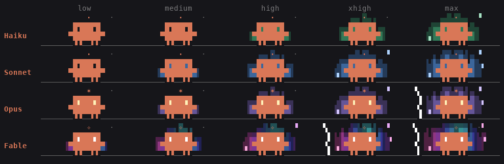
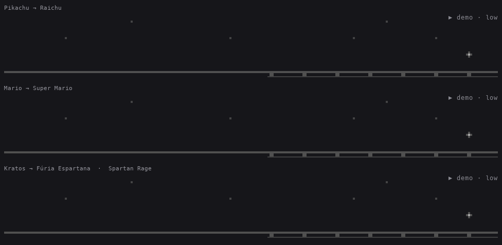
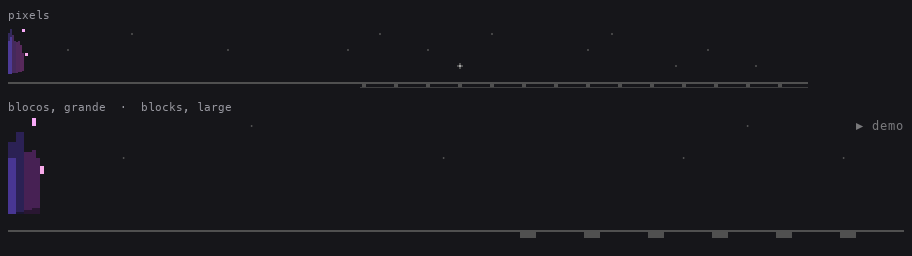

# legends-claude

[English](README.md) · **Português**

Uma barra acima do prompt do Claude Code que mostra o que importa enquanto você trabalha: **modelo e effort**, **custo da sessão e do turno**, **limites de uso**, **cada agente em execução**, o seu **nível** (de 1 a 100, pelos tokens que você já gastou) e um **palco** onde o mascote do Claude Code constrói, tijolo por tijolo, o que o turno está fazendo. O mascote muda com o **modelo** e com o **effort**: quanto mais forte o modelo e mais alto o effort, mais ele brilha. Não mostra barra de contexto.


A barra ocupa a largura toda do terminal. Num terminal estreito, modelo, custo e limites empilham em linhas próprias.

## O que aparece

| Linha | O que mostra |
| --- | --- |
| Régua | A linha de cima. Com trabalho em curso, um pulso `━` nasce no centro e corre para as duas pontas: mais largo e mais rápido quanto maior o effort. |
| Cabeçalho | Modelo e effort do último pedido, **clicáveis** (veja Uso). A faísca é a da classe do modelo (`✢` Haiku, `✻` Sonnet, `❋` Opus, `❂` Fable; veja O poder): pulsa enquanto o turno roda e fica apagada quando está ocioso. Custo e limites encostam à direita na mesma linha quando cabem. |
| Custo | Total da sessão (o mesmo que `/cost` soma, subagentes incluídos) e quanto foi gasto desde o último prompt. Duas casas decimais (`$1.75`). O total acende com `▲` por um instante sempre que cresce. Quando outra sessão também gastou hoje (ou esta vem de ontem), vem ainda o custo do dia, somado entre as sessões: `hoje $9.80`. |
| Limites | Janelas de 5 horas e 7 dias, com quanto falta para zerar. Quando, no ritmo dos últimos minutos, uma janela enche antes de zerar, a barra diz em quanto tempo (`enche em ~40m`): em âmbar, e em vermelho com menos de um quarto de hora. Só aparece em contas que reportam limite. |
| Contexto | Quanto da janela de contexto do modelo a conversa ocupa: um medidor, a porcentagem e os tokens sobre a janela (`contexto ▰▰▰▱▱▱▱▱▱▱ 31% · 62k/200k`), com o botão `⟳ compactar` à direita. A partir de 70% a linha sugere compactar, em âmbar (`hora de compactar?`); a partir de 85%, em vermelho, antes que o Claude Code compacte sozinho. O botão pede confirmação: o primeiro clique o troca por `⟳ confirmar compactação?`, e só um segundo clique em até 5 segundos compacta. Ao passar de 70% subindo, um aviso aparece também, uma vez. Logo depois de uma compactação (e numa sessão nova) não há leitura até a próxima resposta: a linha mostra só o tamanho da janela. |
| Nível | O seu nível, de 1 a 100, pelos tokens que você já gastou com a barra acompanhando: um medidor até o próximo nível e a porcentagem (`nível 23 ▰▰▰▰▱▱▱▱▱▱ 41%`), e à direita o título, o total e quanto falta (`Construtor · 12,3M · faltam 1,2M`). Veja [Níveis](#níveis-de-1-a-100). |
| Palco | Quatro linhas de cena (oito no tamanho grande), enquanto há um turno ou um agente rodando: em pixels de verdade, em blocos de terminal, em vetor ou em texto, o que a tela conseguir mostrar. Veja abaixo. |
| Trabalho | Com o palco desligado: um cometa de faíscas `✳✶✻·····`, tempo decorrido, quantas ferramentas foram chamadas, quantas falharam e a última delas. Com o palco ligado, essas informações ficam no placar do canto dele. |
| Agentes | Uma linha por subagente, teammate ou agente de workflow: o nome surge de um punhado de faíscas que assentam letra a letra; depois, a faísca da classe do modelo dele pulsando (na cor do ajudante dele no palco), brilho no nome e um cometa próprio, cada um fora de fase do vizinho; o que ele faz agora (o resumo que o Claude Code guarda dele; antes de haver um, a descrição da tarefa); um minigráfico da atividade dele (`▂▁▅█`), tempo, ferramentas, falhas, quanto já custou e a última chamada. Ao terminar vira `✓` com um estouro de faíscas que rareia, duração, tokens e custo (ou `✗` se falhou) e some depois de 8 segundos. Um agente chamado por outro agente fica logo abaixo dele, recuado com `└`. Por padrão no máximo 6 linhas (3, 6 ou 10 na aba de ajustes); o resto vira `+N agentes`. No terminal, um clique na linha põe a transcrição do agente na tela (veja Uso). |

## O palco

O palco não é um desenho em loop: ele reage ao que está acontecendo de verdade.

- **O mascote** é o do logo do Claude Code (`▐▛███▜▌` / `▝▜█████▛▘` / `▘▘ ▝▝`), ponto a ponto. Ele entra pela esquerda quando o turno começa e espera no meio da pista.
- **Pensando, escrevendo ou esperando.** O sinal sobre a cabeça acompanha o que o pedido ao modelo faz, trecho a trecho da resposta. Enquanto o modelo pensa, a faísca da classe dele pulsa e os olhos vão de um lado para o outro. Quando a resposta começa a sair, a faísca dá lugar a três pontinhos, um aceso de cada vez (`·●·`). Quando ele monta a chamada de uma ferramenta, aparece o nome dela com um cursor piscando (`Bash▁`). Enquanto a ferramenta roda, o nome ganha reticências (`Bash···`) e ele sobe e desce as garras. Um ajudante mostra as fases do agente dele do mesmo jeito. O sinal só aparece com o bicho parado: andando ou carregando tijolos, não há nenhum.
- **Cada ferramenta é um tijolo.** Uma chamada de ferramenta vira um tijolo na pilha da esquerda, na cor da família dela. O mascote vai buscar, leva na cabeça (até seis por viagem; com a pilha grande ele aperta o passo), põe na esteira, e a esteira leva até a **parede** que cresce à direita, em fiadas alternadas. O tijolo recém-chegado acende. A parede fica de um turno para o outro: é o retrato do que a sessão fez.
- **O que falhou racha.** Uma chamada que termina em erro (um teste que quebrou, um comando que saiu com erro, uma edição que não casou) ou é recusada racha o tijolo dela: ele segue para a parede na cor da família, apagada, e, onde há detalhe, com a rachadura desenhada. A parede passa a mostrar quanto do trabalho foi retrabalho.
- **Andares.** A cada cem tijolos a sessão fecha um andar: sobem fogos sobre a parede. `/legends-claude stats` conta quantos já foram.
- **Ajudantes.** Quando o Claude dispara um subagente, o mascote para, grita `!`, e um ajudante menor brota atrás dele numa nuvem de faíscas, na cor do agente (a mesma da faísca dele na lista). O ajudante carrega os tijolos das ferramentas do próprio agente. Agente à espera: o ajudante senta e dorme (`z`). Agente terminado: ele pula, ganha `✓` e some em faíscas; se falhou, apaga e leva `✗`. Até seis ajudantes em cena.
- **O fim.** Quando o turno termina com uma resposta, o mascote comemora: com três ferramentas ou mais, pulos e confete nas cores dos tijolos; num turno curto, só um pulinho. Um turno interrompido ou que acabou em erro não tem festa: a cena se recolhe.
- **O placar** no canto de cima à direita mostra o tempo do turno, quantas ferramentas ele chamou, quantas falharam e a última delas. Onde o palco é uma imagem não há lugar para texto: o placar é a linha de trabalho, logo abaixo dele.

As cores dos tijolos:

| Cor | Família | Exemplos |
| --- | --- | --- |
| azul | ler | `Read`, `NotebookRead` |
| lilás | buscar | `Grep`, `Glob`, `ToolSearch` |
| verde | editar e escrever | `Edit`, `Write`, `NotebookEdit` |
| âmbar | shell | `Bash`, `KillShell` |
| ciano | web | `WebFetch`, `WebSearch` |
| rosa | agentes | `Agent`, `Task`, `SendMessage` |
| laranja | ferramentas MCP | `mcp__servidor__ferramenta` |
| cinza | o resto | `TodoWrite`, `Skill`, `AskUserQuestion` |

Para ver o palco sem esperar um turno: `/legends-claude demo` (ou o botão **▶ demonstração** na aba de ajustes) roda um turno de mentira de uns 30 segundos, com as fases do pedido, ajudantes e confete.

## O poder: modelo e effort

O mascote não é sempre o mesmo. A **classe do modelo** decide quem ele é; o **effort** do pedido, quanta energia ele solta.



| Classe | Faísca | Aura | O que mais |
| --- | --- | --- | --- |
| Haiku | `✢` | verde, a partir de `high` | o mascote de sempre |
| Sonnet | `✻`, a do Claude Code | azul, a partir de `medium` | uma faixa de luz atravessa o corpo de tempos em tempos |
| Opus | `❋` | roxa, a partir de `medium` | olhos acesos em ouro; faixa dourada, mais larga e mais frequente; raios em `max`; fogos de ouro na festa do fim |
| Fable | `❂` | furta-cor (do ciano ao rosa, correndo), já em `low` | olhos acesos em branco; brilho furta-cor que mal passa e já recomeça; **voa** em vez de andar (sem patas, com jatos por baixo); raios a partir de `xhigh`; fogos de todas as cores |

- **A faísca** de cada classe é a do cabeçalho, a das linhas de agente e a que pulsa sobre a cabeça de quem pensa: do pontinho de Haiku ao selo de Fable. Um modelo de família desconhecida fica com a de Sonnet.
- **O effort faz a aura crescer.** Em `low` não há nenhuma; em `medium`, um clarão baixo em volta do corpo; daí para cima, cada nível alarga o clarão e sobe as labaredas, que se mexem a cada quadro. De `high` para cima, quem corre risca o ar atrás de si (só de Sonnet para cima); de `xhigh` para cima, sobem fagulhas pelos lados. Em Fable tudo começa um nível antes; em Haiku, um depois. O pulso da régua acompanha: mais largo e mais rápido.
- **Os olhos** do mascote são dois vazios: com aura, ela aparece através deles. De Opus para cima eles têm luz própria.
- **Cada ajudante tem o poder do seu agente**: o modelo e o effort com que ele roda. A aura de um ajudante é menor que a do mascote; dormindo ou depois de falhar, ele fica sem nenhuma.
- **Fora de um turno**, quando só os ajudantes ainda trabalham, o mascote descansa: segue com os olhos e o brilho da classe, sem a energia do effort.
- **Num tema claro** a aura clareia em direção ao branco, em vez de escurecer; os raios têm a cor do texto do tema.
- **Os avatares coloridos têm aura própria.** A cor da classe é a aura do Clawd e dos ajudantes. Pikachu, Mario, Kratos e Elsa têm cada um a aura do seu elemento e, com ela forte, se transformam: veja [Mascotes](#mascotes-clawd-pikachu-mario-kratos-e-elsa).
- O poder é só desenho: não muda o que o palco conta (cada ferramenta segue sendo um tijolo) nem a velocidade de ninguém.

Para ver uma combinação sem trocar de modelo: `/legends-claude demo opus max` roda a demonstração com essa aparência (um modelo, um effort, ou os dois; uma palavra que não é nem um nem outro é recusada com um aviso). Na demonstração, um ajudante é um Sonnet em `high` e o outro um Haiku em `max`.

Como o palco de texto é desenhado: cada célula do terminal vale 2×2 "subpixels", desenhados com os blocos de quadrante (`▘▝▖▗▀▄▌▐…`), e a cor de fundo permite duas cores na mesma célula. Por isso o mascote anda de meia em meia célula e pula de meia em meia linha. Os outros jeitos de desenhá-lo estão em [Resolução](#resolução-pixels-blocos-vetor-ou-texto). A cena é uma simulação pura, quadro a quadro, sem sorteio: o mesmo estado desenha sempre o mesmo quadro.

A animação só roda enquanto há o que mostrar (um turno, um agente, a demonstração, ou a cena terminando: um tijolo na esteira, o confete caindo). Parada, a barra não redesenha e não gasta nada.

## Mascotes: Clawd, Pikachu, Mario, Kratos e Elsa



Quem é o mascote no palco se escolhe na aba de ajustes (`⚙`), na linha `mascote`. A troca vale na hora e fica salva.

| Mascote | Como é | A aura dele | Com a aura forte |
| --- | --- | --- | --- |
| Clawd | O de sempre, o do logo do Claude Code, de uma cor só: a cor de destaque dos ajustes. | A cor da classe do modelo. | O mesmo de sempre. |
| Pikachu | Amarelo, de orelhas de ponta escura, bochechas vermelhas e o rabo em raio. | **Raio**: um campo elétrico azul, de contorno espetado, com estalos amarelos em volta. | Vira **Raichu**: laranja, de barriga branca, bochechas amarelas, orelhas e patas marrons, e o rabo fino que termina num raio. |
| Mario | Boné e camisa vermelhos, bigode, macacão azul de botões amarelos, luvas brancas. | **Estrela**: o arco-íris inteiro, correndo, com estrelinhas de ouro subindo. | Vira **Super Mario**: de capa amarela, dos ombros aos pés. |
| Kratos | Pele de cinza, a faixa vermelha sobre o olho, barba, ombreira dourada e saiote de couro. | **Fogo**: labaredas laranja de pontas vermelhas, amarelas rente ao corpo, com brasas subindo. | Entra em **fúria**: a faixa e os olhos acendem, a pele pega o calor do fogo e os punhos ardem. |
| Elsa | Trança loira sobre o ombro, sombra lilás nos olhos, vestido azul de gelo até o chão, mangas e capa transparentes. | **Gelo**: o azul de uma noite de inverno, com cristais de pontas claras em volta e flocos de neve caindo. | Vira o **quinto espírito**: de cabelo solto e vestido branco, com mangas lilases e losangos de gelo. |

- **A barra também pode escolher.** `por modelo` põe em cena o avatar da classe do modelo: Pikachu em Haiku, Mario em Sonnet, Kratos em Opus e Elsa em Fable; trocou o modelo, troca o mascote. `por sessão` tira um avatar colorido do id da sessão: o mesmo a sessão inteira, e quase sempre outro na sessão ao lado, o que ajuda a distinguir janelas. Nos dois casos a aba diz quem está em cena.
- **Dois desenhos por avatar colorido, e por forma com poder.** O fino (36×20 pontos) aparece onde há detalhe: em pixels, em vetor e em blocos no tamanho `grande`. Em blocos no tamanho `normal` e no palco de texto vai uma versão de baixa resolução (18×5), bem mais simples: é o que cabe em blocos de quadrante com duas cores por célula.
- **Tudo o que o Clawd faz, eles fazem.** Piscam, olham para os lados quando pensam, levantam os braços para carregar e comemorar, andam, sentam para dormir, apagam quando falham.
- **A aura é do personagem, não da classe.** Num avatar colorido as tintas da aura (e dos riscos, das fagulhas e dos jatos) são as do elemento dele, em qualquer modelo. É uma aura mais viva que o clarão de uma classe, com três camadas onde há detalhe: o coração, mais claro, rente ao corpo; o miolo; e as pontas e beiradas. O effort segue dando o tamanho dela, e a classe, o resto: a faísca, a faixa de brilho, as pupilas acesas de Opus para cima, o voo de Fable e os fogos. A faixa de brilho é mais leve sobre um avatar colorido, para ele seguir aparecendo por baixo dela.
- **A transformação vem com o effort.** O avatar muda de forma quando a aura chega à força em que as fagulhas sobem: de `xhigh` para cima em Sonnet e Opus, já em `high` em Fable, só em `max` em Haiku. Fora de um turno, dormindo ou depois de falhar ele volta ao desenho de base.
- **O raio é do Pikachu.** Os estalos aparecem com qualquer aura, e desde que ele vira Raichu caem raios amarelos ao lado dele, em qualquer classe e mais vezes que os de Opus e Fable. Fogo, estrela e gelo seguem a regra da classe para os raios.
- **A neve é da Elsa.** O contorno da aura dela é de cristais: cada ponta tem o seu lugar e cresce ou encolhe devagar, em vez de ondular como as labaredas ou saltar como o campo do raio. O miolo é a camada mais apagada (é vidro: deixa o fundo aparecer) e quem brilha são as pontas e as beiradas. E o que ela solta são flocos de neve: caem pelos lados em vez de subir, pousam acima do chão e derretem ali. Num tema claro as pontas, as beiradas e os flocos trocam o ciano claro e o branco por um azul fechado, para não sumirem no fundo. O vestido vai até o chão: no lugar das pernas, a barra dele e as pontas da capa balançam de um passo para o outro. E os olhos seguem azuis com qualquer modelo: de Opus para cima acende só a linha de baixo de cada um, e fechados ou de lado eles não acendem.
- **As cores são deles.** A cor de destaque dos ajustes não pinta um avatar colorido; segue valendo no resto da barra (a faísca, o modelo, o cometa, a régua).
- **Os ajudantes não mudam**: seguem sendo os pequenos Clawds, cada um na cor do seu agente.
- A escolha é só desenho: todos têm a largura e a cabeça do Clawd, então o palco conta a mesma história com qualquer um (onde ele para, quantos tijolos carrega).

A Elsa está aqui em homenagem à minha filha: com ela como mascote, a aba de ajustes diz isso ao lado da linha `mascote`.

Pikachu, Raichu, Mario, Kratos e Elsa são personagens e marcas dos seus donos (Nintendo / The Pokémon Company, Sony Interactive Entertainment e Disney). Os desenhos daqui são pixel art feita por fãs, sem vínculo com essas empresas nem endosso delas.

## Resolução: pixels, blocos, vetor ou texto

O palco é uma cena só, desenhada de quatro jeitos. A barra escolhe o melhor que a tela consegue mostrar (o ajuste **resolução**, `automática` por padrão) e a aba de ajustes diz qual está em uso.



| Sai em | Onde | O que se vê |
| --- | --- | --- |
| **pixels** | um terminal que desenha imagens: kitty, Ghostty, iTerm2 3.5 ou mais novo com a renderização em tela cheia do Claude Code (dentro do tmux também, com `allow-passthrough` e `focus-events` ligados) | A cena como uma imagem de verdade, 8×16 pixels para cada célula: tijolos com relevo, uma faixa de luz inclinada cruzando o corpo, chamas que deixam ver o fundo, partículas de poucos pixels, e ícones em pixels sobre as cabeças (a faísca de quem pensa, os pontinhos de quem escreve, um ícone para a família da ferramenta, que acende e apaga enquanto a chamada é montada e fica cheio e balança enquanto ela roda, `!`, `✓`, `✗`, `z`). |
| **blocos** | qualquer outro terminal | Uma grade de células do terminal. Cada célula fica com o bloco que mais se aproxima dos pixels dela (`▁▂▃▄▅▆▇`, `▏▎▍▌▋▊▉`, as metades, os quadrantes) e duas cores: as chamas terminam em qualquer oitavo de célula. Os sinais, o placar, o chão e as estrelas seguem como texto. |
| **vetor** | o app desktop | O mesmo desenho, em SVG. |
| **texto** | a resolução `clássica`, ou uma versão do Claude Code sem os elementos novos | O palco de sempre: caracteres de quadrante, 2×2 "subpixels" para cada célula. |

- **Movimento mais suave.** Em pixels e em blocos o palco é repintado no lugar entre dois quadros da simulação, perto de 25 vezes por segundo, enquanto a barra segue sendo redesenhada 8 vezes por segundo: os bichos deslizam de onde estavam para onde vão, os tijolos correm na esteira e as faíscas voam, em vez de pular. Em blocos um bicho anda de meia em meia célula, o menor passo que um bloco desenha sobre o fundo do próprio terminal.
- **Como a barra descobre.** Num terminal, o primeiro desenho leva uma imagem transparente de um pixel num canto e pede ao Claude Code que a repinte: a resposta diz se o terminal desenha imagens. Até ela chegar (uma fração de segundo) o palco fica em blocos. Se as imagens param de funcionar no meio do caminho (um tmux sem passthrough, por exemplo), o palco volta sozinho aos blocos.
- **Tamanho.** `grande` dobra o palco (oito linhas) e dá ao mundo dele a metade da largura da barra, então cada bloco mostra mais: em blocos aparecem o relevo dos tijolos, o volume do corpo, a faixa de luz inclinada e a linha do chão, como em pixels. Precisa de um terminal com pelo menos 118 colunas e de 11 linhas livres na faixa; sem isso o palco fica no tamanho de sempre e a aba de ajustes avisa. Não tem efeito no palco de texto.
- Uma imagem não leva texto: em pixels e em vetor o placar volta para a linha de trabalho, logo abaixo do palco.
- Para manter o palco exatamente como era antes da versão 0.9, escolha `clássica`. Para perguntar de novo ao terminal se ele desenha imagens (depois de ligar o passthrough do tmux, por exemplo), escolha `automática` outra vez.

## Níveis: de 1 a 100

A linha do nível mede quanto você já trabalhou com o Claude Code, não quanto uma sessão custou. Ela soma os tokens de cada turno (a conversa principal e os agentes), de todas as sessões, desde sempre.

- **O que conta:** entrada, saída e escrita no cache. A leitura do cache fica de fora: é a mesma conversa relida a cada pedido, e contá-la faria o nível medir o tamanho do contexto, não o trabalho.
- **A curva:** o nível L pede 2 bilhões × ((L−1)/99)^2,5 tokens. Os primeiros níveis vêm rápido (o 2 com uns 20 mil tokens, o 10 com uns 5 milhões); o 100 pede 2 bilhões, mais de um ano de uso pesado.
- **Títulos,** um a cada dez níveis: Aprendiz (1–10), Iniciado, Artesão, Construtor, Arquiteto, Mestre, Veterano, Lendário, Mítico e Imortal (91–100). O título vem na cor de destaque; de Lendário para cima, em âmbar; no nível 100, em vermelho, com o medidor cheio e `MAX`.
- **Subir de nível** mostra um aviso (`Nível 31! Construtor`) e toca a fanfarra, quando o ajuste `som` está ligado.
- O interruptor `nível` na aba de ajustes esconde a linha (e o aviso); `/legends-claude stats` também mostra o nível, o título e os tokens.

## Instalação

No prompt de uma sessão do Claude Code no terminal:

```
/plugin install legends-claude --marketplace leolegends/legends-claude
```

Ou direto do shell:

```
claude plugin install legends-claude --marketplace leolegends/legends-claude
```

O Claude Code pergunta `Add marketplace?` (responda `y`) e depois o escopo: escolha **user** para a barra valer em todas as sessões. Ele passa a funcionar na hora, sem reiniciar.

No app desktop, onde `/plugin` não roda: clique em **+** ao lado do prompt, depois **Plugins**, **Add marketplace** com `leolegends/legends-claude` e **Add plugin**.

Para atualizar: `claude plugin update legends-claude` e depois `/reload-plugins`.
Para remover: `claude plugin uninstall legends-claude`.

## Uso

- **Clique no modelo** (`Fable 5.2`) abre um seletor na própria barra: `modelo  ● Fable  Opus  Sonnet  Haiku  ✕`. Clicar num deles roda `/model <nome>`, como se você tivesse digitado: a troca é a da sessão e, como todo `/model`, fica salva como padrão das próximas.
- **Clique no effort** (`high`) abre `effort  low  medium  ● high  xhigh  max  ✕` e roda `/effort <nível>`.
- No meio de um turno a troca entra na fila e vale quando o turno termina. `✕` (ou clicar de novo no modelo/effort) fecha o seletor sem trocar nada.
- **Clique na linha de um agente** (no terminal) põe a transcrição dele na tela, como a troca pela lista de tarefas do Claude Code. A barra passa a dizer de quem é (`vendo Explore · buscar rotas  ← principal`) e sublinha o nome dele na lista. `← principal`, ou outro clique na mesma linha, volta à conversa principal. Se o Claude Code não troca a vista, um aviso repete o motivo.
- **Pelo teclado.** `ctrl+x tab` leva o foco para a barra: `Tab` ou as setas andam pelos botões (as linhas de agente incluídas) e `Enter` aperta. O anel de foco acompanha o que abre: num seletor ele já cai na opção em vigor (o modelo da sessão, o effort do último pedido), e na aba de ajustes, no idioma; ao fechar, volta ao botão que abriu. `Esc`, ou começar a digitar, devolve o foco ao prompt.
- `▾` no canto da barra esconde; `◂ status` traz de volta. `/legends-claude` alterna entre escondido e visível.
- `/legends-claude demo` mostra o palco em ação, com a sessão parada. `/legends-claude demo fable max` mostra com outro modelo e effort, sem trocar os da sessão.
- `/legends-claude compactar` compacta a conversa na hora, sem confirmação: roda o `/compact` do próprio Claude Code, que aparece na conversa e espera a sessão ficar parada. O que vem depois da palavra vai para o resumo como instrução (`/legends-claude compactar mantenha o plano`). `compact` também vale.
- `/legends-claude stats` mostra as contas: os tijolos (cada ferramenta chamada é um), os andares, as falhas e os turnos desta sessão; o custo de hoje somado entre as sessões; o total de sempre; e os recordes (o turno mais longo, o que mais chamou ferramentas, mais agentes de uma vez); e o nível, com o título e os tokens que contam para ele. O texto aparece na conversa só para você: não vai para o modelo.
- **`⚙` abre a aba de ajustes** na própria barra (ou `/legends-claude ajustes`; `settings` também serve). Cada mudança vale na hora e fica salva para as próximas sessões:

```
⚙ ajustes                                          ▶ demonstração   restaurar padrão   ✕
idioma       ● Português  English
cor          ● Claude  Azul  Verde  Roxo  Rosa  Ciano  Âmbar  Mono
mascote      ● Clawd  Pikachu  Mario  Kratos  Elsa  por modelo  por sessão
som          ● mudo  baixo  alto
animação     ● completa  suave  parada
velocidade   lenta  ● normal  rápida
resolução    ● automática  blocos  clássica    em uso: blocos
tamanho      ● normal  grande
mostrar      ☑ régua  ☑ palco  ☑ contexto  ☑ nível  ☑ limites  ☑ custo do turno  ☑ custo do dia
agentes      3  ● 6  10
```

| Ajuste | O que faz |
| --- | --- |
| idioma | Português ou inglês: muda na hora todos os textos da barra, os avisos e a descrição do comando. Sem uma escolha salva, uma instalação nova segue o idioma do sistema (`LC_ALL`, `LC_MESSAGES`, `LANG`): português se ele disser `pt`, senão inglês. "Restaurar padrão" não mexe no idioma. |
| cor | A cor de destaque: o mascote, a faísca, o modelo, o cometa, o pulso da régua, o custo aceso. Cada opção já aparece na própria cor. `Claude` e `Mono` seguem o tema claro/escuro do Claude Code. |
| mascote | Quem é o mascote no palco. `Clawd` é o de sempre, na cor de destaque. `Pikachu`, `Mario`, `Kratos` e `Elsa` são avatares coloridos, com cores próprias (a cor de destaque segue valendo no resto da barra): em pixels, em vetor e em blocos no tamanho grande aparecem no desenho fino; em blocos no tamanho normal e no palco de texto, numa versão de baixa resolução. Cada avatar colorido tem a aura do seu elemento (raio, estrela, fogo, gelo) e se transforma com o effort alto (Raichu, Super Mario, Kratos em fúria, o quinto espírito); o brilho, os olhos acesos e o voo seguem a classe do modelo. `por modelo` e `por sessão` deixam a escolha com a barra (veja [Mascotes](#mascotes-clawd-pikachu-mario-kratos-e-elsa)). Os ajudantes seguem sendo os pequenos Clawds. |
| som | Os sons da barra, de oito bits, feitos pelo próprio mod (não há arquivo de áudio): a fanfarra de um turno que trabalhou, um plim num turno curto, um ajudante que nasce, uma falha (um turno que acabou em erro, um agente que falhou), um andar que fecha, e duas batidas quando o Claude te faz uma pergunta ou espera a aprovação de um plano. `mudo` é o padrão; escolher um volume toca uma amostra. Só toca no macOS: nos outros sistemas a aba avisa. |
| animação | `completa` é tudo, palco incluído; `suave` deixa só a faísca pulsando e o cometa (sem palco, pulso na régua, nome surgindo, brilho nem estouro); `parada` não mexe nada e só atualiza o tempo uma vez por segundo. |
| velocidade | A duração de um quadro: 200, 125 ou 80 ms. É também o ritmo do palco. Sem efeito com a animação parada. |
| resolução | Em que o palco é desenhado. `automática` é o melhor que a tela oferece: pixels de verdade num terminal que desenha imagens, blocos de terminal nos outros, vetor no app desktop. `blocos` mantém os blocos mesmo onde há pixels. `clássica` é o palco de texto. Ao lado das opções, a aba diz o que está em uso nesta tela. |
| tamanho | `normal` é o palco de quatro linhas; `grande` dobra o palco (veja [Resolução](#resolução-pixels-blocos-vetor-ou-texto)). Só vale fora do palco de texto, e onde a barra tem espaço. |
| mostrar | Liga e desliga a régua de cima, o palco, a linha do contexto, a linha do nível, os limites de 5h/7d, o custo do turno e o custo do dia. O palco só aparece com a animação `completa`. |
| agentes | Quantas linhas de agente aparecem antes do resumo `+N agentes`. |

## Requisitos e limites

- Claude Code com suporte a mods (function hooks). Escrito e testado nas versões 2.1.322, 2.1.327 e 2.1.330. Essa API está em acesso antecipado e pode mudar entre versões.
- A barra precisa de pelo menos 60 colunas de terminal; abaixo disso ela não desenha. Numa barra com mais de 120 colunas o palco não estica além disso.
- A faixa acima do prompt pode ocupar até metade da altura do terminal. Se o palco não couber (menos de 7 linhas livres) ele não entra e a linha de trabalho volta; se couber justo, é a lista de agentes que encolhe para `+N agentes`.
- O palco em pixels precisa de um terminal que desenhe imagens (o protocolo gráfico do kitty com placeholders, ou as imagens embutidas do iTerm2) e de uma versão do Claude Code com as peças `Image`, `Raster` e `$.ui.blit` da API de mods. Onde falta alguma delas a barra recua sozinha: para blocos, e de blocos para texto.
- O palco em blocos e em texto usa os caracteres de Block Elements (`▀▄█▌▐`, os oitavos, os quadrantes) e cor de 24 bits. Num terminal sem cor de 24 bits as cores dos tijolos e da aura são aproximadas; numa fonte sem esses blocos o desenho não fecha.
- Em pixels, em blocos e em vetor as cores são pintadas como RGB, não como cores do tema: as que vêm do tema do Claude Code (a cor `Claude` do mascote, as dos ajudantes, o chão) são aproximações próximas para o tema claro e para o escuro.
- Repintar o palco entre os quadros custa de um a três milissegundos por vez (medido fora do Claude Code), e só enquanto a cena se mexe e o palco está à vista.
- A faísca de cada classe usa glifos do bloco Dingbats (`✢ ✣ ✤`, `✸ ✹ ✺ ❋`, `✧ ✦ ✪ ❂ ❉`), como a do próprio Claude Code; numa fonte sem algum deles o terminal mostra o substituto dele.
- A aura esmaece para o fundo do terminal, e o mod só sabe se o tema é claro ou escuro pelo nome dele (a linha `theme` do `/config`): um tema cujo nome não diz `light` vale como escuro.
- O custo, o resumo e a atividade de cada agente vêm da lista de agentes do Claude Code, conferida uma vez por segundo. Numa versão que não os traz, a linha mostra a descrição da tarefa e, ao terminar, os tokens do último turno.
- Enquanto o Claude Code espera por você com um diálogo na tela (um pedido de permissão, uma pergunta), ele não desenha a faixa acima do prompt: a barra some e volta quando você responde. E os avisos de permissão, de notificação e de compactação da conversa não chegam a um mod (visto na versão 2.1.330, numa conta de equipe). Por isso o palco não tem cena para esses momentos; o que há é o som da pergunta, que o mod reconhece pela ferramenta. O botão da linha do contexto também não ouve a compactação: ele a pede, pelo `/compact`, que é um comando que um mod pode rodar.
- A previsão do limite sai das leituras que a barra viu nesta sessão (os últimos 30 minutos na janela de 5 horas, as últimas 6 horas na de 7 dias) e pede um mínimo de tempo e de subida: logo que a sessão abre não há previsão. O percentual é o da conta, então o uso de outras sessões entra no ritmo.
- As contas contam o que a barra viu: uma sessão sem o plugin carregado não entra, e o custo é a estimativa do Claude Code (numa assinatura não é cobrança). Cada sessão grava só o registro dela, ao fim de cada turno, e é aí que relê os das outras (no máximo uma vez por minuto): com esta sessão parada, o custo do dia na barra não acompanha o que as outras gastam. Um registro parado há três dias entra no total de sempre e sai do store. O nível sai das mesmas contas: tokens gastos numa sessão sem o plugin não contam, e uma instalação nova começa no nível 1.
- O effort aparece a partir do primeiro pedido ao modelo depois que o plugin carrega; antes disso a barra mostra `effort`, já clicável.
- O seletor de modelo usa os apelidos `fable`, `opus`, `sonnet` e `haiku`; um modelo que a sua conta não tem é recusado pelo próprio `/model`, e a barra avisa.
- As linhas de agente só são clicáveis no terminal; no app desktop seguem como texto. Quem troca a vista é o Claude Code, e só em resposta a um clique ou a uma tecla sua: ele pode recusar (um agente que já saiu da lista de tarefas, um teammate num painel próprio), e a barra mostra o motivo.
- O anel de foco só acompanha o que abre e fecha com o teclado na barra (`ctrl+x tab`). Na versão 2.1.327 um clique num botão o aperta sem dar o teclado a ela, então para quem usa o mouse nada muda.
- As fases do pedido saem dos trechos da resposta do modelo, que a barra repassa adiante como vieram. Ela só olha de que tipo cada trecho é (raciocínio, texto, começo de uma chamada) e o nome da ferramenta chamada: não guarda nem mostra o texto.
- O plugin não acessa rede nem arquivos. Ele lê o uso da sessão, a lista de agentes, o tema (a linha `theme` do `/config`, e a troca dela), o id da sessão e o sistema operacional; guarda o estado na sessão e, no store do próprio plugin (um JSON na pasta de configuração do Claude Code), os ajustes e as contas (um registro por sessão, com contagens e custo por dia: nenhum texto da conversa); lê três variáveis de ambiente (`LC_ALL`, `LC_MESSAGES`, `LANG`) para escolher o primeiro idioma; e toca os sons pelo próprio Claude Code. A cena do palco vive só na memória e recomeça a cada sessão ou `/reload-plugins`.
- O palco é enfeite: um erro nele vira uma cena vazia e uma linha de aviso, nunca atrapalha uma ferramenta nem derruba a barra.
- O ícone `⚙` é desenhado como texto na maioria dos terminais; num terminal que o mostre como emoji largo, a primeira linha pode perder uma coluna à direita.

## Desenvolvimento

```
claude plugin validate .
claude plugin test .
claude --plugin-dir .        # roda uma sessão com o plugin carregado desta pasta
```

O módulo de hooks e o que ele importa, em `hooks/`:

- `register.tsx`: os eventos, o estado, o relógio da animação e a montagem do que a barra desenha. `bar.tsx`: a barra montada (a régua, o cabeçalho com os botões, as linhas), pura. `stage-draw.tsx`: da cena ao elemento do palco de um desenho. `engine-calls.ts`: o que a barra pede ao engine sem mexer no estado dela (o aviso de erro, o tema, os ajustes salvos, o anel de foco, a troca da vista).
- `lines.ts`: as linhas da barra (cabeçalho, custo, trabalho, limites, agentes), puras. `bar-rows.tsx`: as linhas de botões sob o cabeçalho (o seletor de modelo ou de effort, e a que diz de qual agente é a transcrição na tela).
- `phase.ts`: o que cada trecho de um pedido ao modelo diz sobre a fase dele (pensa, escreve, monta uma chamada). `focus.ts`: em que botão o anel de foco cai quando algo abre na barra.
- `context-line.ts`: a linha do contexto, pura: o medidor, a sugestão de compactar e o botão.
- `level.ts`: o nível, puro: a curva, os títulos e a linha.
- `pace.ts`: o ritmo de uma janela de limite e a previsão de quando ela enche. `stats.ts`: as contas de uma sessão, do dia e de sempre, puras; `ledger.ts`: o registro delas no store do plugin. `sound.ts`: os sons, da melodia ao WAV.
- `effects.ts`: as animações de texto (faísca, cometa, pulso da régua, nome surgindo, estouro, brilho).
- `format.ts`, `parts.ts`, `agents.ts`: formatos de texto, trechos de linha, e as linhas de agente conferidas com a lista do engine.
- `sim.ts`: a simulação do palco, pura: o estado e as funções que dão o estado seguinte.
- `scene.ts`: o desenho de um quadro da cena em texto (balões, tijolos, esteira, estrelas). `pose.ts`: o que cada bicho está fazendo num quadro, usado pelo palco de texto e pelo de pixels.
- `hd.ts`, `hd-aura.ts`, `hd-art.ts`: a mesma cena em pixels, entre dois quadros da simulação: uma lista de retângulos de tinta, com a aura, as partículas e os desenhos miúdos (tijolos com relevo, ícones, chão).
- `canvas.ts`, `png.ts`, `blocks.ts`, `vector.ts`: dos retângulos a um quadro de pixels, a um PNG (o mod não tem zlib: o codificador é próprio), a células de terminal (o bloco e as duas cores que mais se aproximam de cada célula) e a SVG.
- `stage.ts`, `stage-node.tsx`, `painter.ts`: em que o palco sai em cada tela, o elemento dele (`Image`, `Raster` ou `Svg`), e o relógio que o repinta entre os quadros e pergunta ao terminal se ele desenha imagens.
- `power.ts`: o poder de quem trabalha: a classe do modelo, o degrau do effort, a força da aura e a faísca de cada classe.
- `aura.ts`: a aparência de um bicho com poder, pura: a aura (a da classe ou a do elemento de um avatar: fogo, raio, estrela, gelo), o brilho do corpo, os olhos, as fagulhas (e os flocos de neve), os estalos, os raios, os jatos e os fogos.
- `pixels.ts`, `sprites.ts`, `palette.ts`, `color.ts`: o desenhador de subpixels (com o clarão de fundo), os desenhos dos bichos, as cores e as contas de cor.
- `avatars.ts`, `elsa.ts`, `avatar-kit.ts`: os avatares coloridos do mascote, como texto: a paleta de cada um, o desenho comum e o fino, com as posturas como remendos sobre ele; e, de cada um, o elemento da aura e a forma com poder (outro desenho, declarado antes do de base). Os desenhos da Elsa têm um arquivo só deles, e `avatar-kit.ts` tem o que todos usam para se desenhar. Um avatar novo é um desenho novo (num arquivo dele), uma entrada em `AVATAR_ART`, uma opção em `settings.ts` e um nome no tipo `StatusAvatar`.
- `demo.ts`: o roteiro da demonstração.
- `i18n.ts`: os textos da barra em português e em inglês. Um texto novo entra no tipo `Strings` e o compilador cobra a tradução nos dois.
- `settings.ts`, `settings-panel.tsx`: os ajustes e a aba deles.
- `types/index.d.ts` (na raiz): o contrato do estado que o plugin guarda.

Os comentários do código e os nomes dos testes estão em português, a língua em que o projeto nasceu.

Os testes (`*.test.ts`, 659 ao todo) cobrem as funções puras, a simulação quadro a quadro, o desenho da cena, o poder de cada classe, a aura e a forma de cada avatar, o codificador de PNG e o ajuste em blocos, e a barra montada em cada superfície, em texto, em blocos, em pixels e em vetor: as fases de um pedido trecho a trecho, a transcrição de um agente na tela e o anel de foco incluídos. O kit de testes não entrega a um teste o pedido de mover o anel de foco (`$.ui.focus`): o anel andando de fato se confere num Claude Code de verdade (`claude --plugin-dir .`, `ctrl+x tab`).

Os GIFs dos dois READMEs saem das mesmas funções que desenham a barra, fora do Claude Code (precisa de `bun` e de Pillow). O turno de mentira tem o palco grande, em blocos, como a maioria dos terminais o mostra, e o mascote troca de avatar a cada trecho: o Clawd em Fable max e, depois, Pikachu (Opus), Mario (Sonnet) e Kratos (Opus), cada um primeiro em `high`, no desenho de base, e depois em `max`, transformado; a linha do nível sobe com o turno e passa do 30 (Artesão) para o 31 (Construtor) no meio dele, com o aviso na legenda; `scripts/demo-frames.ts` segue dando um turno com um modelo e um effort só. A tabela de poderes é a mesma nos dois idiomas:

```
bun run scripts/cast-frames.ts 112 en | python3 scripts/demo-gif.py docs/demo.gif 10
bun run scripts/cast-frames.ts 112 pt | python3 scripts/demo-gif.py docs/demo.pt-BR.gif 10
bun run scripts/power-frames.ts | python3 scripts/demo-gif.py docs/power.gif
```

O GIF do palco em pixels é feito só do palco, em duas faixas que andam juntas (os arquivos de quadros são grandes: deixe-os fora do repositório):

```
bun run scripts/stage-frames.ts /tmp/pixels.bin 100 pixels normal fable max
bun run scripts/stage-frames.ts /tmp/grande.bin 112 blocos grande fable max
python3 scripts/stage-gif.py docs/stage.gif "pixels=/tmp/pixels.bin" "blocos, grande  ·  blocks, large=/tmp/grande.bin"
# o GIF dos mascotes: o último argumento de stage-frames.ts é o avatar; com o effort `escada`, ele sobe de low a max ao longo da demonstração
for a in pikachu mario kratos elsa; do bun run scripts/stage-frames.ts /tmp/$a.bin 120 pixels grande opus escada escuro $a; done
python3 scripts/stage-gif.py docs/avatars.gif "Pikachu → Raichu=/tmp/pikachu.bin" "Mario → Super Mario=/tmp/mario.bin" "Kratos → Fúria Espartana  ·  Spartan Rage=/tmp/kratos.bin" "Elsa → Quinto Espírito  ·  Fifth Spirit=/tmp/elsa.bin"
```

A documentação tem dois arquivos, que mudam juntos: `README.md` (inglês) e `README.pt-BR.md` (português).

## Créditos e licença

MIT. Algumas funções auxiliares foram adaptadas de [claude-statuspane](https://github.com/xuanji86/claude-statuspane) (MIT), de Anji Xu. A ideia de desenhar o mascote com os elementos de imagem da própria tela, e não só com caracteres, veio do [claud-in](https://github.com/two2dope/claud-in), de two2Dope, cujo mascote é um SVG no app desktop. As animações seguem técnicas da skill `ascii-animations` (grade de caracteres, máquina de estados, onda que se propaga, partículas), adaptadas para o terminal.
